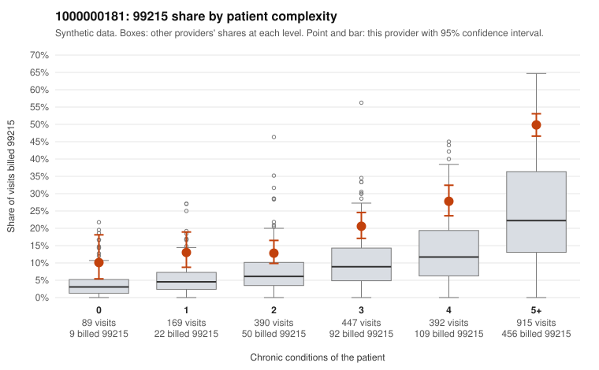

# 1000000181: 1000000181: documented 99215 claims mostly support the level billed (0% below)

**Leaning (advisory):** Pattern consistent with a high-acuity panel

## Why

1000000181 billed 99215 on 30.7% of 2,402 claims against an expected 12.5% given patient complexity (risk-adjusted score 10.62; plain z-score vs peers 3.94). 4% of this provider's 99215 claims were on patients with 0 or 1 chronic conditions. Records came back for 29 claims. Of 7 documented 99215 claims, 0 (0%) were documented below the billed level, against 54% for the comparison providers. Note checks on 29 returned notes (share showing each sign): problems 0%, late 7%, unsigned 0%, data 14%. No audit trail was received. 4 of 21 notes claiming moderate-or-higher data reviewed had no lab or test line on the claim. This pattern is consistent with a high-acuity panel. The sampled documentation supports the billed level. Examples: C0104721: billed 99215; documented MDM level high, 52 minutes. C0105544: billed 99215; documented MDM level high, 52 minutes. C0105632: billed 99215; documented MDM level high, 54 minutes. C0104877: billed 99215, patient aged 94 with 5 chronic condition(s) (type 2 diabetes;obesity;hypertension;heart failure;chronic kidney disease). C0104940: billed 99215, patient aged 64 with 5 chronic condition(s) (type 2 diabetes;atrial fibrillation;COPD;asthma;chronic kidney disease).

## Evidence chart

## Cited claims

`C0104721`, `C0105544`, `C0105632`, `C0104877`, `C0104940`

## Suggested next steps

- Do not pursue recovery on this evidence: 29 charts came back and they support the level billed (0 of 7 documented 99215 claims below the billed level).
- Revisit if the 99215 share keeps rising against peers or a larger sample shows unsupported claims.

---
Citations checked: 5/5 valid. Synthetic data. The leaning is advisory; the flag comes from the statistical screen, and no clinical documentation is available beyond the sampled records-review facts shown in the packet.
