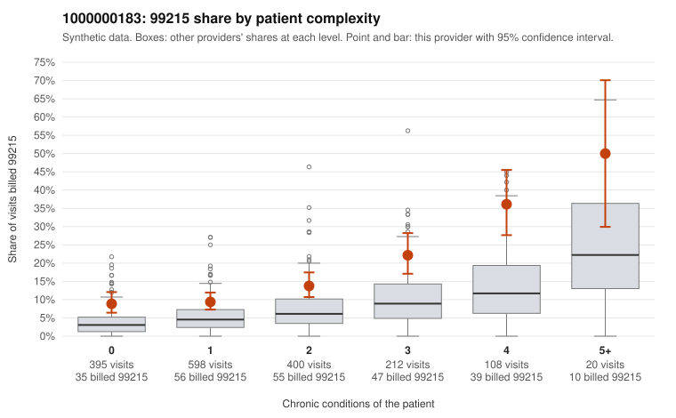

# 1000000183: 1000000183: documented 99215 claims mostly support the level billed (25% below)

**Leaning (advisory):** Pattern consistent with a high-acuity panel

## Why

1000000183 billed 99215 on 14.0% of 1,733 claims against an expected 5.2% given patient complexity (risk-adjusted score 6.23; plain z-score vs peers 1.09). 38% of this provider's 99215 claims were on patients with 0 or 1 chronic conditions. Records came back for 30 claims. Of 8 documented 99215 claims, 2 (25%) were documented below the billed level, against 54% for the comparison providers. Note checks on 30 returned notes (share showing each sign): problems 13%, late 3%, unsigned 0%, data 7%. No audit trail was received. 2 of 20 notes claiming moderate-or-higher data reviewed had no lab or test line on the claim. This pattern is consistent with a high-acuity panel. The sampled documentation supports the billed level. Examples: C0107420: billed 99215; documented MDM level high, 53 minutes. C0108015: billed 99215; documented MDM level high, 46 minutes. C0108230: billed 99215; documented MDM level high, minutes not recorded. C0107425: billed 99215, patient aged 65 with 5 chronic condition(s) (type 2 diabetes;hyperlipidemia;depression;hypertension;osteoarthritis). C0107488: billed 99215, patient aged 62 with 4 chronic condition(s) (hypothyroidism;type 2 diabetes;depression;COPD).

## Evidence chart

## Cited claims

`C0107420`, `C0108015`, `C0108230`, `C0107425`, `C0107488`

## Suggested next steps

- Do not pursue recovery on this evidence: 30 charts came back and they support the level billed (2 of 8 documented 99215 claims below the billed level).
- Revisit if the 99215 share keeps rising against peers or a larger sample shows unsupported claims.

---
Citations checked: 5/5 valid. Synthetic data. The leaning is advisory; the flag comes from the statistical screen, and no clinical documentation is available beyond the sampled records-review facts shown in the packet.
