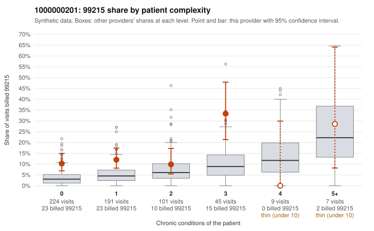

# 1000000201: 1000000201: too few returned records to judge

**Leaning (advisory):** Inconclusive

## Why

1000000201 billed 99215 on 12.7% of 577 claims against an expected 4.5% given patient complexity (risk-adjusted score 3.54; plain z-score vs peers 0.87). 63% of this provider's 99215 claims were on patients with 0 or 1 chronic conditions. Records came back for 24 claims. Of 1 documented 99215 claims, 0 (0%) were documented below the billed level, against 54% for the comparison providers. Note checks on 24 returned notes (share showing each sign): problems 33%, late 8%, unsigned 0%, data 12%. No audit trail was received. 3 of 14 notes claiming moderate-or-higher data reviewed had no lab or test line on the claim. The evidence does not support a call either way yet. Examples: C0118445: billed 99215, patient aged 80 with 1 chronic condition(s) (obesity). C0118454: billed 99215, patient aged 39 with 1 chronic condition(s) (hyperlipidemia).

## Evidence chart

## Cited claims

`C0118445`, `C0118454`

## Suggested next steps

- 24 charts came back but do not settle it: request a targeted sample of 99215 charts, starting with C0118445, C0118454.
- Re-check after the targeted charts arrive; do not call upcoding or a sicker panel on this evidence alone.

---
Citations checked: 2/2 valid. Synthetic data. The leaning is advisory; the flag comes from the statistical screen, and no clinical documentation is available beyond the sampled records-review facts shown in the packet.
