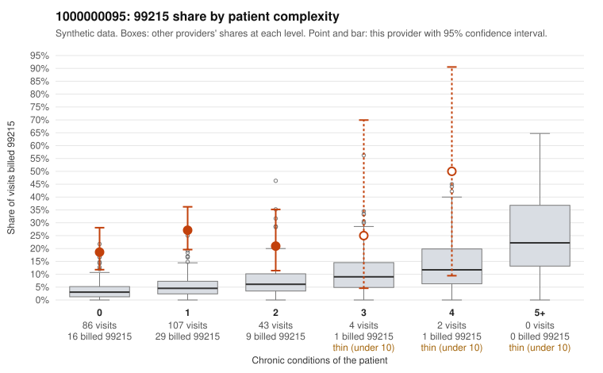

# Payment Integrity dossier: 1000000095

> Draft for human review. Statistical and records-sample evidence only; not a finding. Compliance or legal review is needed before any provider contact, notice or recoupment.

## Provider overview

| | |
|---|---|
| Specialty / state | Family Practice, GA (synthetic) |
| Claims / patients | 242 / 121 |
| Billed mix (99211 to 99215) | 4 / 7 / 46 / 129 / 56 |
| 99215 share | 23.1% |
| Expected 99215 share given patient complexity | 4.1% |
| Screen scores | z vs peers 2.65; risk-adjusted 5.72; flagged by eb_ratio |

## Case summary (advisory)

**1000000095: 1 of 20 documented 99215 claims (5%) are documented below the billed level**

Leaning: pattern consistent with upcoding. Citations checked: 4/4 valid.

1000000095 billed 99215 on 23.1% of 242 claims against an expected 4.1% given patient complexity (risk-adjusted score 5.72; plain z-score vs peers 2.65). 80% of this provider's 99215 claims were on patients with 0 or 1 chronic conditions. Records came back for 45 claims. Of 20 documented 99215 claims, 1 (5%) were documented below the billed level, against 54% for the comparison providers. Note checks on 45 returned notes (share showing each sign): problems 60%, late 20%, unsigned 0%, data 20%, bulk created 7%, paste heavy 7%. 10 of 40 notes claiming moderate-or-higher data reviewed had no lab or test line on the claim. This pattern is consistent with upcoding. It is a reason to review the records, not a finding. Examples: C0053347: billed 99215, patient aged 57 with 1 chronic condition(s) (obesity); documented MDM level moderate, minutes not recorded. C0053291: billed 99215, patient aged 51 with 1 chronic condition(s) (type 2 diabetes). C0053304: billed 99215, patient aged 46 with 0 chronic condition(s). C0053311: billed 99215, patient aged 62 with 1 chronic condition(s) (osteoarthritis).

## Evidence chart

## Records-review sample so far

Documentation is on file for 45 claims (19% of this provider's claims).

| Billed | Documented | Documentation below billed level | Rate | All-provider rate |
|---|---|---|---|---|
| 99213 | 5 | 0 | 0.0% | 3.4% |
| 99214 | 20 | 2 | 10.0% | 8.5% |
| 99215 | 20 | 1 | 5.0% | 53.6% |

## Recommended next steps for Payment Integrity

1. Request records for the sampled claims in `record_request_list.csv` (31 claims across 99215).
2. Review the records against E/M documentation rules and record the supported level for each claim.
3. Run the overpayment estimator on the reviewed sample (`sampling_plan.md` explains how).
4. Notice, appeal rights, recoupment, education or corrective action, and any referral are decisions for the PI team, compliance and counsel. Nothing here drafts those.

Suggested follow-ups from the case summary:

- Request the full charts for C0053347, C0053291, C0053304 and have a certified coder re-score each against the current E/M rules (medical decision making or total time).
- If the re-scoring confirms the pattern, review the random sample in the recovery packet's sampling plan before any overpayment estimate; do not extrapolate from a targeted sample.
- Look at the notes themselves: 60% address fewer problems than their level implies and 20% were signed late; request the audit trail for C0053347, C0053291, C0053304.

## Limits

- Synthetic data; no real claims or providers.
- The leaning is advisory. The flag comes from the statistical screen; the summary explains it.
- The records-review sample is partial and was simulated for this project.
- Allowed amounts are GA Family Practice averages from a public CMS file, not this provider's actual payments.
