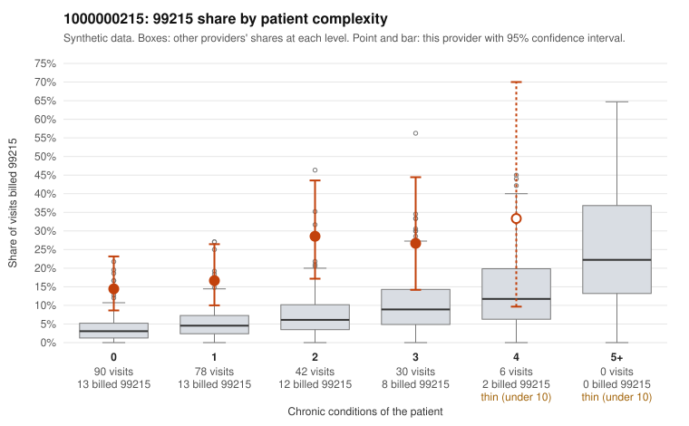

# 1000000215: 1000000215: 6 of 8 documented 99215 claims (75%) are documented below the billed level

**Leaning (advisory):** Pattern consistent with upcoding

## Why

1000000215 billed 99215 on 19.5% of 246 claims against an expected 4.5% given patient complexity (risk-adjusted score 4.26; plain z-score vs peers 2.04). 54% of this provider's 99215 claims were on patients with 0 or 1 chronic conditions. Records came back for 28 claims. Of 8 documented 99215 claims, 6 (75%) were documented below the billed level, against 54% for the comparison providers. Note checks on 28 returned notes (share showing each sign): problems 18%, late 4%, unsigned 0%, data 11%. No audit trail was received. 3 of 17 notes claiming moderate-or-higher data reviewed had no lab or test line on the claim. This pattern is consistent with upcoding. It is a reason to review the records, not a finding. Examples: C0126031: billed 99215, patient aged 42 with 1 chronic condition(s) (hypertension); documented MDM level moderate, 39 minutes. C0126048: billed 99215; documented MDM level low, minutes not recorded. C0126132: billed 99215; documented MDM level moderate, 38 minutes. C0126021: billed 99215, patient aged 76 with 1 chronic condition(s) (asthma). C0126027: billed 99215, patient aged 42 with 1 chronic condition(s) (hypertension).

## Evidence chart

## Cited claims

`C0126031`, `C0126048`, `C0126132`, `C0126021`, `C0126027`

## Suggested next steps

- Request the full charts for C0126031, C0126048, C0126132 and have a certified coder re-score each against the current E/M rules (medical decision making or total time).
- If the re-scoring confirms the pattern, review the random sample in the recovery packet's sampling plan before any overpayment estimate; do not extrapolate from a targeted sample.
- Look at the notes themselves: 18% address fewer problems than their level implies and 4% were signed late; request the audit trail for C0126031, C0126048, C0126132.

---
Citations checked: 5/5 valid. Synthetic data. The leaning is advisory; the flag comes from the statistical screen, and no clinical documentation is available beyond the sampled records-review facts shown in the packet.
