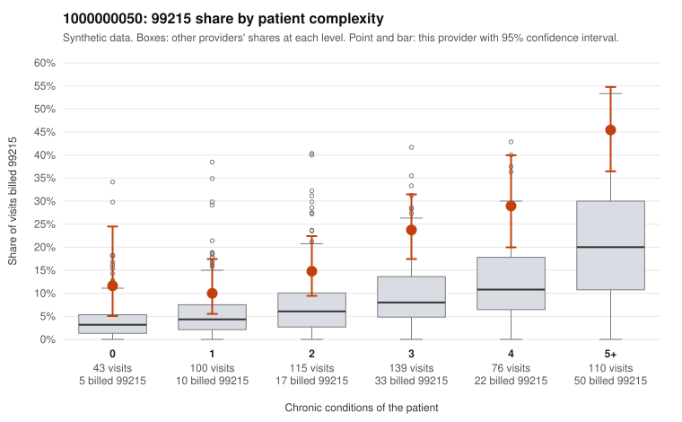

# 1000000050: 1000000050: documented 99215 claims mostly support the level billed (12% below)

**Leaning (advisory):** Pattern consistent with a high-acuity panel

## Why

1000000050 billed 99215 on 23.5% of 583 claims against an expected 8.0% given patient complexity (risk-adjusted score 5.05; plain z-score vs peers 2.71). 11% of this provider's 99215 claims were on patients with 0 or 1 chronic conditions. Records came back for 30 claims. Of 8 documented 99215 claims, 1 (12%) were documented below the billed level, against 44% for the comparison providers. Note checks on 30 returned notes (share showing each sign): problems 7%, late 13%, unsigned 0%, data 3%. No audit trail was received. 2 of 20 notes claiming moderate-or-higher data reviewed had no lab or test line on the claim. This pattern is consistent with a high-acuity panel. The sampled documentation supports the billed level. Examples: C0020971: billed 99215; documented MDM level high, 33 minutes. C0021140: billed 99215; documented MDM level high, 42 minutes. C0021182: billed 99215; documented MDM level high, 33 minutes. C0020738: billed 99215, patient aged 59 with 5 chronic condition(s) (obesity;hyperlipidemia;depression;heart failure;osteoarthritis). C0020829: billed 99215, patient aged 85 with 4 chronic condition(s) (type 2 diabetes;obesity;hyperlipidemia;osteoarthritis).

## Evidence chart

## Cited claims

`C0020971`, `C0021140`, `C0021182`, `C0020738`, `C0020829`

## Suggested next steps

- Do not pursue recovery on this evidence: 30 charts came back and they support the level billed (1 of 8 documented 99215 claims below the billed level).
- Revisit if the 99215 share keeps rising against peers or a larger sample shows unsupported claims.

---
Citations checked: 5/5 valid. Synthetic data. The leaning is advisory; the flag comes from the statistical screen, and no clinical documentation is available beyond the sampled records-review facts shown in the packet.
