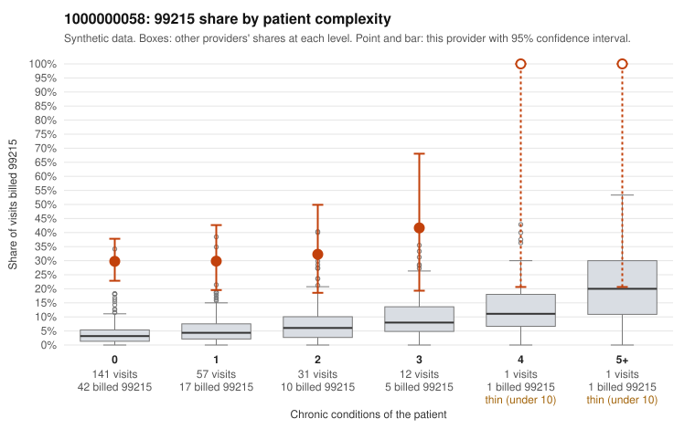

# 1000000058: Heavy 99215 billing on mostly low-complexity patients looks like upcoding, but returned charts largely support the billed level, though note-quality signals suggest the documentation may be cloned or inflated.

**Leaning (advisory):** Inconclusive

## Why

1000000058 billed 99215 on 31.3% of 243 claims against an expected 3.8% given patient complexity (risk-adjusted score 8.23; plain z-score vs peers 4.02). 78% of this provider's 99215 claims were on patients with 0 or 1 chronic conditions. Records came back for 30 claims. Of 11 documented 99215 claims, 1 (9%) were documented below the billed level, against 44% for the comparison providers. Note checks on 30 returned notes (share showing each sign): problems 57%, late 30%, unsigned 0%, data 20%. No audit trail was received. 6 of 22 notes claiming moderate-or-higher data reviewed had no lab or test line on the claim. The claims pattern points toward upcoding: the excess 99215 share holds even among patients with no chronic conditions. Sampled 99215s include follow-up and minor-acute diagnoses such as C0025445, C0025451 and C0025488 (Z09) and C0025444 and C0025567 (J06.9), where high-complexity visits would be unusual. The documentation points the other way: the 11 documented 99215 claims show an unsupported rate far below the comparison providers, and charts such as C0025410 and C0025451 record high MDM on single-condition or no-condition patients. That combination is itself a concern, and the note signals give some reason to doubt the charts reflect what happened: a high share of duplicate-like and late notes, data reviewed at moderate or higher on claims with no lab or test line, and no audit trail. These are weak signals, not proof, and only 11 documented 99215s is thin, so neither reading can be settled yet. A reviewer should first compare the high-MDM notes on low-complexity 99215s (C0025451, C0025410 and the below-billed C0025437) against each other for cloned text. They should also obtain the EHR audit trail to check note creation timing, and request charts for more of the sampled zero-condition 99215 claims. Examples: C0025437: billed 99215; documented MDM level moderate, minutes not recorded. C0025403: billed 99215, patient aged 73 with 1 chronic condition(s) (type 2 diabetes). C0025410: billed 99215, patient aged 38 with 1 chronic condition(s) (type 2 diabetes); documented MDM level high, 48 minutes.

## Evidence chart

## Cited claims

`C0025437`, `C0025403`, `C0025410`

## Suggested next steps

- 30 charts came back but do not settle it: request a targeted sample of 99215 charts, starting with C0025437, C0025403, C0025410.
- Re-check after the targeted charts arrive; do not call upcoding or a sicker panel on this evidence alone.

---
Citations checked: 3/3 valid. Synthetic data. The leaning is advisory; the flag comes from the statistical screen, and no clinical documentation is available beyond the sampled records-review facts shown in the packet.
