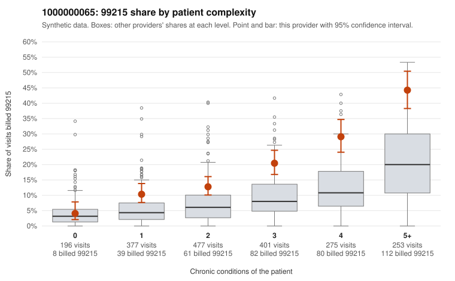

# 1000000065: 1000000065: documented 99215 claims mostly support the level billed (0% below)

**Leaning (advisory):** Pattern consistent with a high-acuity panel

## Why

1000000065 billed 99215 on 19.3% of 1,979 claims against an expected 7.3% given patient complexity (risk-adjusted score 7.61; plain z-score vs peers 2.00). 12% of this provider's 99215 claims were on patients with 0 or 1 chronic conditions. Records came back for 30 claims. Of 7 documented 99215 claims, 0 (0%) were documented below the billed level, against 44% for the comparison providers. Note checks on 30 returned notes (share showing each sign): problems 13%, late 7%, unsigned 0%, data 0%. No audit trail was received. 1 of 26 notes claiming moderate-or-higher data reviewed had no lab or test line on the claim. This pattern is consistent with a high-acuity panel. The sampled documentation supports the billed level. Examples: C0027490: billed 99215; documented MDM level high, 35 minutes. C0028176: billed 99215; documented MDM level high, minutes not recorded. C0028440: billed 99215, patient aged 39 with 1 chronic condition(s) (chronic kidney disease); documented MDM level high, minutes not recorded. C0027455: billed 99215, patient aged 69 with 4 chronic condition(s) (type 2 diabetes;hyperlipidemia;hypertension;osteoarthritis). C0027495: billed 99215, patient aged 77 with 5 chronic condition(s) (hyperlipidemia;depression;heart failure;osteoarthritis;chronic kidney disease).

## Evidence chart

## Cited claims

`C0027490`, `C0028176`, `C0028440`, `C0027455`, `C0027495`

## Suggested next steps

- Do not pursue recovery on this evidence: 30 charts came back and they support the level billed (0 of 7 documented 99215 claims below the billed level).
- Revisit if the 99215 share keeps rising against peers or a larger sample shows unsupported claims.

---
Citations checked: 5/5 valid. Synthetic data. The leaning is advisory; the flag comes from the statistical screen, and no clinical documentation is available beyond the sampled records-review facts shown in the packet.
