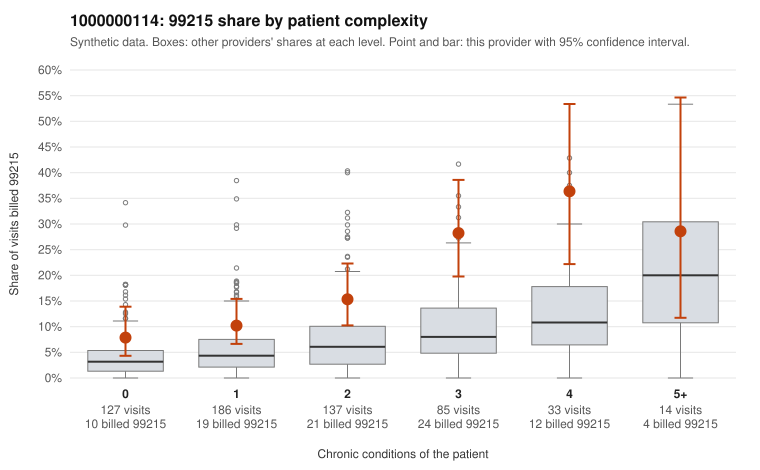

# 1000000114: 1000000114: documented 99215 claims mostly support the level billed (17% below)

**Leaning (advisory):** Pattern consistent with a high-acuity panel

## Why

1000000114 billed 99215 on 15.5% of 582 claims against an expected 5.3% given patient complexity (risk-adjusted score 4.00; plain z-score vs peers 1.36). 32% of this provider's 99215 claims were on patients with 0 or 1 chronic conditions. Records came back for 30 claims. Of 6 documented 99215 claims, 1 (17%) were documented below the billed level, against 44% for the comparison providers. Note checks on 30 returned notes (share showing each sign): problems 27%, late 3%, unsigned 0%, data 0%. No audit trail was received. 0 of 21 notes claiming moderate-or-higher data reviewed had no lab or test line on the claim. This pattern is consistent with a high-acuity panel. The sampled documentation supports the billed level. Examples: C0052176: billed 99215; documented MDM level high, 50 minutes. C0052250: billed 99215; documented MDM level high, 47 minutes. C0052360: billed 99215, patient aged 18 with 0 chronic condition(s); documented MDM level high, minutes not recorded. C0052108: billed 99215, patient aged 85 with 5 chronic condition(s) (hyperlipidemia;atrial fibrillation;heart failure;osteoarthritis;chronic kidney disease). C0052200: billed 99215, patient aged 68 with 4 chronic condition(s) (type 2 diabetes;hyperlipidemia;hypertension;asthma).

## Evidence chart

## Cited claims

`C0052176`, `C0052250`, `C0052360`, `C0052108`, `C0052200`

## Suggested next steps

- Do not pursue recovery on this evidence: 30 charts came back and they support the level billed (1 of 6 documented 99215 claims below the billed level).
- Revisit if the 99215 share keeps rising against peers or a larger sample shows unsupported claims.

---
Citations checked: 5/5 valid. Synthetic data. The leaning is advisory; the flag comes from the statistical screen, and no clinical documentation is available beyond the sampled records-review facts shown in the packet.
