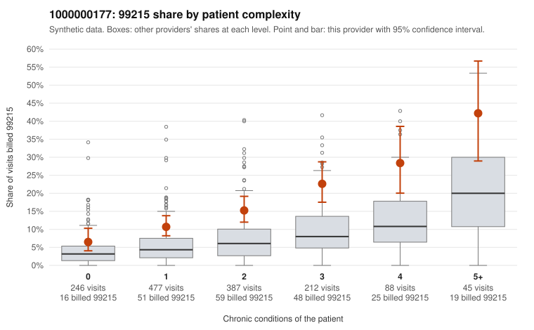

# 1000000177: 1000000177: documented 99215 claims mostly support the level billed (19% below)

**Leaning (advisory):** Pattern consistent with a high-acuity panel

## Why

1000000177 billed 99215 on 15.0% of 1,455 claims against an expected 5.5% given patient complexity (risk-adjusted score 5.87; plain z-score vs peers 1.28). 31% of this provider's 99215 claims were on patients with 0 or 1 chronic conditions. Records came back for 45 claims. Of 21 documented 99215 claims, 4 (19%) were documented below the billed level, against 44% for the comparison providers. Note checks on 45 returned notes (share showing each sign): problems 29%, late 2%, unsigned 0%, data 4%. No audit trail was received. 3 of 34 notes claiming moderate-or-higher data reviewed had no lab or test line on the claim. This pattern is consistent with a high-acuity panel. The sampled documentation supports the billed level. Examples: C0077632: billed 99215; documented MDM level high, 48 minutes. C0078193: billed 99215; documented MDM level high, 53 minutes. C0078727: billed 99215; documented MDM level high, 45 minutes. C0077681: billed 99215, patient aged 81 with 5 chronic condition(s) (hypothyroidism;hypertension;heart failure;COPD;chronic kidney disease). C0077738: billed 99215, patient aged 63 with 5 chronic condition(s) (hypothyroidism;type 2 diabetes;obesity;hypertension;chronic kidney disease).

## Evidence chart

## Cited claims

`C0077632`, `C0078193`, `C0078727`, `C0077681`, `C0077738`

## Suggested next steps

- Do not pursue recovery on this evidence: 45 charts came back and they support the level billed (4 of 21 documented 99215 claims below the billed level).
- Revisit if the 99215 share keeps rising against peers or a larger sample shows unsupported claims.

---
Citations checked: 5/5 valid. Synthetic data. The leaning is advisory; the flag comes from the statistical screen, and no clinical documentation is available beyond the sampled records-review facts shown in the packet.
