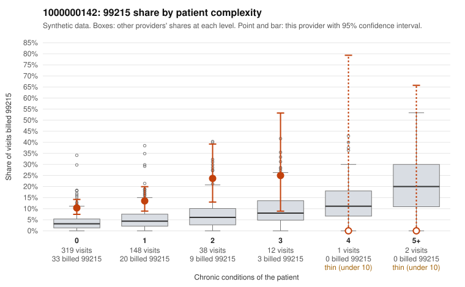

# Payment Integrity dossier: 1000000142

> Draft for human review. Statistical and records-sample evidence only; not a finding. Compliance or legal review is needed before any provider contact, notice or recoupment.

## Provider overview

| | |
|---|---|
| Specialty / state | Family Practice, GA (synthetic) |
| Claims / patients | 520 / 246 |
| Billed mix (99211 to 99215) | 20 / 31 / 189 / 215 / 65 |
| 99215 share | 12.5% |
| Expected 99215 share given patient complexity | 3.6% |
| Screen scores | z vs peers 0.86; risk-adjusted 3.93; flagged by eb_ratio |

## Case summary (advisory)

**1000000142: 11 of 16 documented 99215 claims (69%) are documented below the billed level**

Leaning: pattern consistent with upcoding. Citations checked: 6/6 valid.

1000000142 billed 99215 on 12.5% of 520 claims against an expected 3.6% given patient complexity (risk-adjusted score 3.93; plain z-score vs peers 0.86). 82% of this provider's 99215 claims were on patients with 0 or 1 chronic conditions. Records came back for 45 claims. Of 16 documented 99215 claims, 11 (69%) were documented below the billed level, against 44% for the comparison providers. Note checks on 45 returned notes (share showing each sign): problems 18%, late 0%, unsigned 0%, data 0%. No audit trail was received. 1 of 18 notes claiming moderate-or-higher data reviewed had no lab or test line on the claim. This pattern is consistent with upcoding. It is a reason to review the records, not a finding. Examples: C0062888: billed 99215; documented MDM level moderate, 33 minutes. C0063107: billed 99215, patient aged 60 with 0 chronic condition(s); documented MDM level moderate, 34 minutes. C0063375: billed 99215, patient aged 82 with 1 chronic condition(s) (type 2 diabetes); documented MDM level moderate, 27 minutes. C0062839: billed 99215, patient aged 36 with 0 chronic condition(s). C0062856: billed 99215, patient aged 48 with 1 chronic condition(s) (asthma). C0062863: billed 99215, patient aged 29 with 1 chronic condition(s) (chronic kidney disease).

## Evidence chart

## Records-review sample so far

Documentation is on file for 45 claims (9% of this provider's claims).

| Billed | Documented | Documentation below billed level | Rate | All-provider rate |
|---|---|---|---|---|
| 99213 | 14 | 2 | 14.3% | 2.8% |
| 99214 | 12 | 12 | 100.0% | 6.9% |
| 99215 | 16 | 11 | 68.8% | 44.4% |

## Recommended next steps for Payment Integrity

1. Request records for the sampled claims in `record_request_list.csv` (34 claims across 99215).
2. Review the records against E/M documentation rules and record the supported level for each claim.
3. Run the overpayment estimator on the reviewed sample (`sampling_plan.md` explains how).
4. Notice, appeal rights, recoupment, education or corrective action, and any referral are decisions for the PI team, compliance and counsel. Nothing here drafts those.

Suggested follow-ups from the case summary:

- Request the full charts for C0062888, C0063107, C0063375 and have a certified coder re-score each against the current E/M rules (medical decision making or total time).
- If the re-scoring confirms the pattern, review the random sample in the recovery packet's sampling plan before any overpayment estimate; do not extrapolate from a targeted sample.
- Look at the notes themselves: 18% address fewer problems than their level implies and 0% were signed late; request the audit trail for C0062888, C0063107, C0063375.

## Limits

- Synthetic data; no real claims or providers.
- The leaning is advisory. The flag comes from the statistical screen; the summary explains it.
- The records-review sample is partial and was simulated for this project.
- Allowed amounts are GA Family Practice averages from a public CMS file, not this provider's actual payments.
