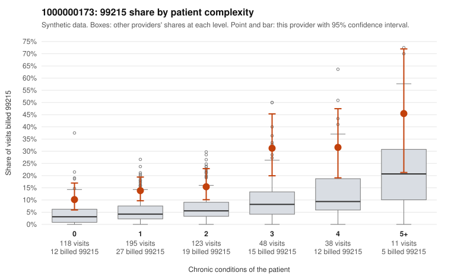

# 1000000173: 1000000173: too few returned records to judge

**Leaning (advisory):** Inconclusive

## Why

1000000173 billed 99215 on 16.9% of 533 claims against an expected 5.1% given patient complexity (risk-adjusted score 4.56; plain z-score vs peers 1.66). 43% of this provider's 99215 claims were on patients with 0 or 1 chronic conditions. Records came back for 30 claims. Of 6 documented 99215 claims, 2 (33%) were documented below the billed level, against 31% for the comparison providers. Note checks on 30 returned notes (share showing each sign): problems 33%, late 3%, unsigned 0%, data 7%. No audit trail was received. 2 of 17 notes claiming moderate-or-higher data reviewed had no lab or test line on the claim. The evidence does not support a call either way yet. Examples: C0088905: billed 99215, patient aged 75 with 1 chronic condition(s) (heart failure); documented MDM level low, minutes not recorded. C0089014: billed 99215, patient aged 42 with 0 chronic condition(s); documented MDM level moderate, minutes not recorded. C0088558: billed 99215, patient aged 34 with 0 chronic condition(s). C0088584: billed 99215, patient aged 61 with 0 chronic condition(s).

## Evidence chart

## Cited claims

`C0088905`, `C0089014`, `C0088558`, `C0088584`

## Suggested next steps

- 30 charts came back but do not settle it: request a targeted sample of 99215 charts, starting with C0088905, C0089014, C0088558.
- Re-check after the targeted charts arrive; do not call upcoding or a sicker panel on this evidence alone.

---
Citations checked: 4/4 valid. Synthetic data. The leaning is advisory; the flag comes from the statistical screen, and no clinical documentation is available beyond the sampled records-review facts shown in the packet.
