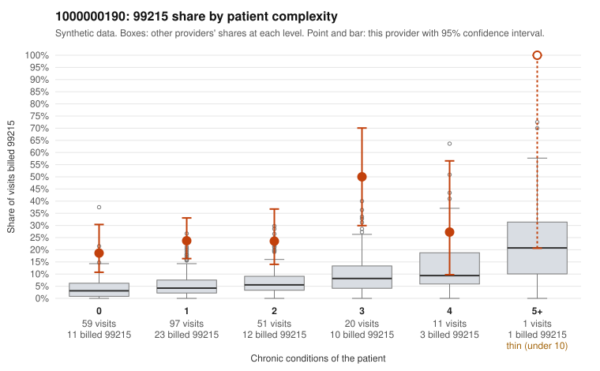

# 1000000190: 1000000190: 12 of 13 documented 99215 claims (92%) are documented below the billed level

**Leaning (advisory):** Pattern consistent with upcoding

## Why

1000000190 billed 99215 on 25.1% of 239 claims against an expected 4.6% given patient complexity (risk-adjusted score 5.60; plain z-score vs peers 3.09). 57% of this provider's 99215 claims were on patients with 0 or 1 chronic conditions. Records came back for 36 claims. Of 13 documented 99215 claims, 12 (92%) were documented below the billed level, against 31% for the comparison providers. Note checks on 36 returned notes (share showing each sign): problems 22%, late 3%, unsigned 0%, data 6%. No audit trail was received. 3 of 24 notes claiming moderate-or-higher data reviewed had no lab or test line on the claim. This pattern is consistent with upcoding. It is a reason to review the records, not a finding. Examples: C0095511: billed 99215, patient aged 24 with 1 chronic condition(s) (hypertension); documented MDM level moderate, 39 minutes. C0095537: billed 99215; documented MDM level moderate, 29 minutes. C0095538: billed 99215, patient aged 23 with 0 chronic condition(s); documented MDM level moderate, 32 minutes. C0095312: billed 99215, patient aged 19 with 1 chronic condition(s) (COPD). C0095321: billed 99215, patient aged 59 with 1 chronic condition(s) (obesity). C0095330: billed 99215, patient aged 51 with 1 chronic condition(s) (COPD).

## Evidence chart

## Cited claims

`C0095511`, `C0095537`, `C0095538`, `C0095312`, `C0095321`, `C0095330`

## Suggested next steps

- Request the full charts for C0095511, C0095537, C0095538 and have a certified coder re-score each against the current E/M rules (medical decision making or total time).
- If the re-scoring confirms the pattern, review the random sample in the recovery packet's sampling plan before any overpayment estimate; do not extrapolate from a targeted sample.
- Look at the notes themselves: 22% address fewer problems than their level implies and 3% were signed late; request the audit trail for C0095511, C0095537, C0095538.

---
Citations checked: 6/6 valid. Synthetic data. The leaning is advisory; the flag comes from the statistical screen, and no clinical documentation is available beyond the sampled records-review facts shown in the packet.
