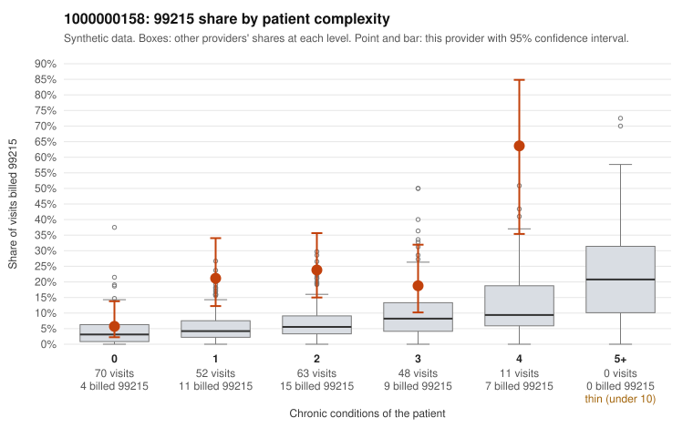

# Payment Integrity dossier: 1000000158

> Draft for human review. Statistical and records-sample evidence only; not a finding. Compliance or legal review is needed before any provider contact, notice or recoupment.

## Provider overview

| | |
|---|---|
| Specialty / state | Family Practice, GA (synthetic) |
| Claims / patients | 244 / 121 |
| Billed mix (99211 to 99215) | 4 / 5 / 79 / 110 / 46 |
| 99215 share | 18.9% |
| Expected 99215 share given patient complexity | 4.9% |
| Screen scores | z vs peers 2.00; risk-adjusted 3.69; flagged by eb_ratio |

## Case summary (advisory)

**1000000158: 4 of 8 documented 99215 claims (50%) are documented below the billed level**

Leaning: pattern consistent with upcoding. Citations checked: 5/5 valid.

1000000158 billed 99215 on 18.9% of 244 claims against an expected 4.9% given patient complexity (risk-adjusted score 3.69; plain z-score vs peers 2.00). 33% of this provider's 99215 claims were on patients with 0 or 1 chronic conditions. Records came back for 30 claims. Of 8 documented 99215 claims, 4 (50%) were documented below the billed level, against 31% for the comparison providers. Note checks on 30 returned notes (share showing each sign): problems 30%, late 7%, unsigned 0%, data 0%. No audit trail was received. 2 of 18 notes claiming moderate-or-higher data reviewed had no lab or test line on the claim. This pattern is consistent with upcoding. It is a reason to review the records, not a finding. Examples: C0083050: billed 99215; documented MDM level moderate, minutes not recorded. C0083101: billed 99215, patient aged 35 with 1 chronic condition(s) (hyperlipidemia); documented MDM level moderate, minutes not recorded. C0083177: billed 99215, patient aged 59 with 0 chronic condition(s); documented MDM level moderate, 39 minutes. C0083063: billed 99215, patient aged 50 with 1 chronic condition(s) (hypothyroidism). C0083100: billed 99215, patient aged 52 with 1 chronic condition(s) (depression).

## Evidence chart

## Records-review sample so far

Documentation is on file for 30 claims (12% of this provider's claims).

| Billed | Documented | Documentation below billed level | Rate | All-provider rate |
|---|---|---|---|---|
| 99213 | 6 | 0 | 0.0% | 4.9% |
| 99214 | 14 | 2 | 14.3% | 6.6% |
| 99215 | 8 | 4 | 50.0% | 30.6% |

## Recommended next steps for Payment Integrity

1. Request records for the sampled claims in `record_request_list.csv` (28 claims across 99215).
2. Review the records against E/M documentation rules and record the supported level for each claim.
3. Run the overpayment estimator on the reviewed sample (`sampling_plan.md` explains how).
4. Notice, appeal rights, recoupment, education or corrective action, and any referral are decisions for the PI team, compliance and counsel. Nothing here drafts those.

Suggested follow-ups from the case summary:

- Request the full charts for C0083050, C0083101, C0083177 and have a certified coder re-score each against the current E/M rules (medical decision making or total time).
- If the re-scoring confirms the pattern, review the random sample in the recovery packet's sampling plan before any overpayment estimate; do not extrapolate from a targeted sample.
- Look at the notes themselves: 30% address fewer problems than their level implies and 7% were signed late; request the audit trail for C0083050, C0083101, C0083177.

## Limits

- Synthetic data; no real claims or providers.
- The leaning is advisory. The flag comes from the statistical screen; the summary explains it.
- The records-review sample is partial and was simulated for this project.
- Allowed amounts are GA Family Practice averages from a public CMS file, not this provider's actual payments.
