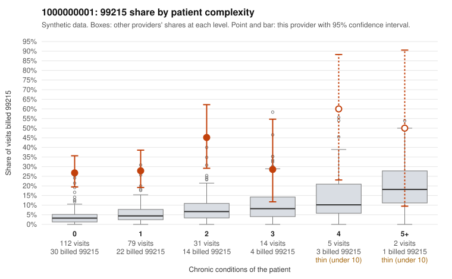

# 1000000001: Provider 1000000001 bills 99215 far above expectation, mostly on low-complexity patients, yet every documented 99215 in the small records sample supports the billed level, with note signals that the documentation may be inflated or cloned.

**Leaning (advisory):** Inconclusive

## Why

1000000001 billed 99215 on 30.5% of 243 claims against an expected 4.5% given patient complexity (risk-adjusted score 7.81; plain z-score vs peers 4.63). 70% of this provider's 99215 claims were on patients with 0 or 1 chronic conditions. Records came back for 30 claims. Of 12 documented 99215 claims, 0 (0%) were documented below the billed level, against 47% for the comparison providers. Note checks on 30 returned notes (share showing each sign): problems 57%, late 20%, unsigned 0%, data 17%. No audit trail was received. 7 of 23 notes claiming moderate-or-higher data reviewed had no lab or test line on the claim. The claims pattern points toward upcoding: the 99215 excess sits mostly on patients with 0 or 1 chronic conditions and simple-looking diagnoses such as rash, back pain and abdominal pain (e.g., C0000001, C0000077, C0000090), not on the few complex patients like C0000059 or C0000203. Against that, none of the 12 documented 99215 claims fell below the billed level, far under the comparison rate, which on its face is consistent with supported billing. That clean result is hard to take at face value. Notes document high MDM on zero-condition visits (C0000085 for rash, C0000186 for back pain), duplicate and problem-list signals are common, and 7 notes claim moderate-or-higher data review with no lab or test on the claim. That is weak evidence the notes may be templated to match the billed code, not proof. With only about an eighth of claims documented and no audit trail, a reviewer should first obtain the audit trail and compare note text across the documented low-complexity 99215s (starting with C0000085, C0000186 and C0000060) for cloned content, then request a larger records sample weighted toward low-complexity 99215 claims. Examples: C0000001: billed 99215, patient aged 29 with 0 chronic condition(s). C0000008: billed 99215, patient aged 27 with 0 chronic condition(s).

## Evidence chart

## Cited claims

`C0000001`, `C0000008`

## Suggested next steps

- 30 charts came back but do not settle it: request a targeted sample of 99215 charts, starting with C0000001, C0000008.
- Re-check after the targeted charts arrive; do not call upcoding or a sicker panel on this evidence alone.

---
Citations checked: 2/2 valid. Synthetic data. The leaning is advisory; the flag comes from the statistical screen, and no clinical documentation is available beyond the sampled records-review facts shown in the packet.
