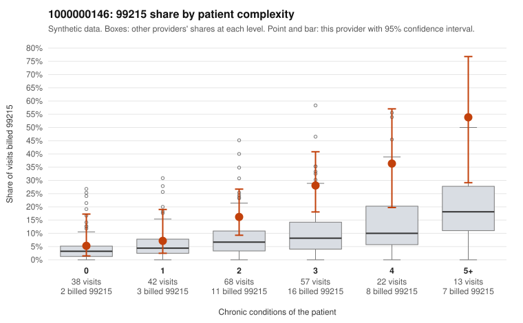

# 1000000146: 1000000146: documented 99215 claims mostly support the level billed (0% below)

**Leaning (advisory):** Pattern consistent with a high-acuity panel

## Why

1000000146 billed 99215 on 19.6% of 240 claims against an expected 6.8% given patient complexity (risk-adjusted score 3.11; plain z-score vs peers 2.48). 11% of this provider's 99215 claims were on patients with 0 or 1 chronic conditions. Records came back for 30 claims. Of 8 documented 99215 claims, 0 (0%) were documented below the billed level, against 47% for the comparison providers. Note checks on 30 returned notes (share showing each sign): problems 13%, late 3%, unsigned 0%, data 0%. No audit trail was received. 0 of 23 notes claiming moderate-or-higher data reviewed had no lab or test line on the claim. This pattern is consistent with a high-acuity panel. The sampled documentation supports the billed level. Examples: C0064898: billed 99215; documented MDM level high, 47 minutes. C0064910: billed 99215, patient aged 59 with 1 chronic condition(s) (heart failure); documented MDM level high, minutes not recorded. C0065066: billed 99215, patient aged 45 with 1 chronic condition(s) (COPD); documented MDM level high, minutes not recorded. C0064941: billed 99215, patient aged 83 with 5 chronic condition(s) (type 2 diabetes;obesity;hyperlipidemia;depression;atrial fibrillation). C0064958: billed 99215, patient aged 56 with 5 chronic condition(s) (hyperlipidemia;depression;hypertension;heart failure;osteoarthritis).

## Evidence chart

## Cited claims

`C0064898`, `C0064910`, `C0065066`, `C0064941`, `C0064958`

## Suggested next steps

- Do not pursue recovery on this evidence: 30 charts came back and they support the level billed (0 of 8 documented 99215 claims below the billed level).
- Revisit if the 99215 share keeps rising against peers or a larger sample shows unsupported claims.

---
Citations checked: 5/5 valid. Synthetic data. The leaning is advisory; the flag comes from the statistical screen, and no clinical documentation is available beyond the sampled records-review facts shown in the packet.
