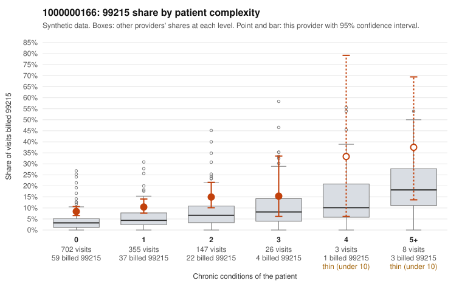

# 1000000166: 1000000166: too few returned records to judge

**Leaning (advisory):** Inconclusive

## Why

1000000166 billed 99215 on 10.2% of 1,241 claims against an expected 4.1% given patient complexity (risk-adjusted score 4.30; plain z-score vs peers 0.62). 76% of this provider's 99215 claims were on patients with 0 or 1 chronic conditions. Records came back for 45 claims. Of 20 documented 99215 claims, 8 (40%) were documented below the billed level, against 47% for the comparison providers. Note checks on 45 returned notes (share showing each sign): problems 42%, late 2%, unsigned 0%, data 9%, bulk created 0%, paste heavy 0%. 5 of 37 notes claiming moderate-or-higher data reviewed had no lab or test line on the claim. The evidence does not support a call either way yet. Examples: C0071543: billed 99215; documented MDM level moderate, 30 minutes. C0071803: billed 99215; documented MDM level moderate, 39 minutes. C0071539: billed 99215, patient aged 38 with 1 chronic condition(s) (heart failure). C0071579: billed 99215, patient aged 54 with 1 chronic condition(s) (hypothyroidism).

## Evidence chart

## Cited claims

`C0071543`, `C0071803`, `C0071539`, `C0071579`

## Suggested next steps

- 45 charts came back but do not settle it: request a targeted sample of 99215 charts, starting with C0071543, C0071803, C0071539.
- Re-check after the targeted charts arrive; do not call upcoding or a sicker panel on this evidence alone.

---
Citations checked: 4/4 valid. Synthetic data. The leaning is advisory; the flag comes from the statistical screen, and no clinical documentation is available beyond the sampled records-review facts shown in the packet.
