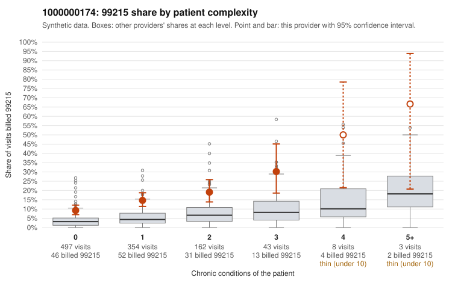

# 1000000174: 1000000174: too few returned records to judge

**Leaning (advisory):** Inconclusive

## Why

1000000174 billed 99215 on 13.9% of 1,067 claims against an expected 4.3% given patient complexity (risk-adjusted score 6.14; plain z-score vs peers 1.35). 66% of this provider's 99215 claims were on patients with 0 or 1 chronic conditions. Records came back for 45 claims. Of 20 documented 99215 claims, 8 (40%) were documented below the billed level, against 47% for the comparison providers. Note checks on 45 returned notes (share showing each sign): problems 60%, late 2%, unsigned 0%, data 0%, bulk created 0%, paste heavy 0%. 2 of 32 notes claiming moderate-or-higher data reviewed had no lab or test line on the claim. The evidence does not support a call either way yet. Examples: C0076668: billed 99215; documented MDM level moderate, 39 minutes. C0077211: billed 99215; documented MDM level moderate, minutes not recorded. C0076651: billed 99215, patient aged 60 with 1 chronic condition(s) (depression). C0076680: billed 99215, patient aged 26 with 1 chronic condition(s) (osteoarthritis).

## Evidence chart

## Cited claims

`C0076668`, `C0077211`, `C0076651`, `C0076680`

## Suggested next steps

- 45 charts came back but do not settle it: request a targeted sample of 99215 charts, starting with C0076668, C0077211, C0076651.
- Re-check after the targeted charts arrive; do not call upcoding or a sicker panel on this evidence alone.

---
Citations checked: 4/4 valid. Synthetic data. The leaning is advisory; the flag comes from the statistical screen, and no clinical documentation is available beyond the sampled records-review facts shown in the packet.
