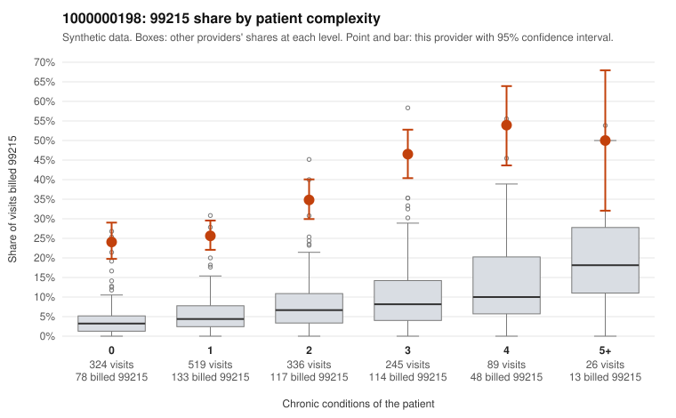

# 1000000198: 1000000198: 0 of 10 documented 99215 claims (0%) are documented below the billed level

**Leaning (advisory):** Pattern consistent with upcoding

## Why

1000000198 billed 99215 on 32.7% of 1,539 claims against an expected 5.6% given patient complexity (risk-adjusted score 18.51; plain z-score vs peers 5.07). 42% of this provider's 99215 claims were on patients with 0 or 1 chronic conditions. Records came back for 30 claims. Of 10 documented 99215 claims, 0 (0%) were documented below the billed level, against 47% for the comparison providers. Note checks on 30 returned notes (share showing each sign): problems 37%, late 13%, unsigned 0%, data 13%, bulk created 7%, paste heavy 10%. 5 of 23 notes claiming moderate-or-higher data reviewed had no lab or test line on the claim. This pattern is consistent with upcoding. It is a reason to review the records, not a finding. Examples: C0087224: billed 99215, patient aged 35 with 1 chronic condition(s) (hyperlipidemia). C0087388: billed 99215, patient aged 28 with 0 chronic condition(s). C0087417: billed 99215, patient aged 47 with 0 chronic condition(s).

## Evidence chart

## Cited claims

`C0087224`, `C0087388`, `C0087417`

## Suggested next steps

- Request the full charts for C0087224, C0087388, C0087417 and have a certified coder re-score each against the current E/M rules (medical decision making or total time).
- If the re-scoring confirms the pattern, review the random sample in the recovery packet's sampling plan before any overpayment estimate; do not extrapolate from a targeted sample.
- Look at the notes themselves: 37% address fewer problems than their level implies and 13% were signed late; request the audit trail for C0087224, C0087388, C0087417.

---
Citations checked: 3/3 valid. Synthetic data. The leaning is advisory; the flag comes from the statistical screen, and no clinical documentation is available beyond the sampled records-review facts shown in the packet.
