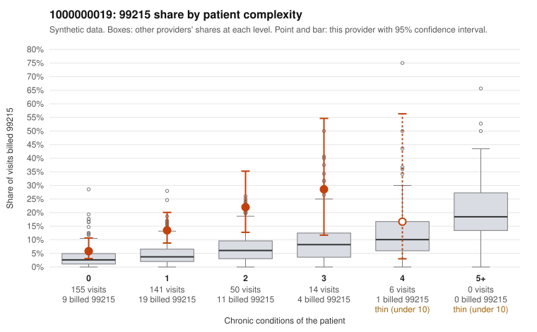

# 1000000019: 1000000019: too few returned records to judge

**Leaning (advisory):** Inconclusive

## Why

1000000019 billed 99215 on 12.0% of 366 claims against an expected 3.6% given patient complexity (risk-adjusted score 3.44; plain z-score vs peers 1.08). 64% of this provider's 99215 claims were on patients with 0 or 1 chronic conditions. Records came back for 45 claims. Of 19 documented 99215 claims, 5 (26%) were documented below the billed level, against 43% for the comparison providers. Note checks on 45 returned notes (share showing each sign): problems 33%, late 0%, unsigned 0%, data 2%. No audit trail was received. 2 of 28 notes claiming moderate-or-higher data reviewed had no lab or test line on the claim. The evidence does not support a call either way yet. Examples: C0009501: billed 99215, patient aged 70 with 1 chronic condition(s) (osteoarthritis); documented MDM level moderate, 36 minutes. C0009593: billed 99215; documented MDM level moderate, 39 minutes. C0009511: billed 99215, patient aged 87 with 1 chronic condition(s) (obesity); documented MDM level high, minutes not recorded.

## Evidence chart

## Cited claims

`C0009501`, `C0009593`, `C0009511`

## Suggested next steps

- 45 charts came back but do not settle it: request a targeted sample of 99215 charts, starting with C0009501, C0009593, C0009511.
- Re-check after the targeted charts arrive; do not call upcoding or a sicker panel on this evidence alone.

---
Citations checked: 3/3 valid. Synthetic data. The leaning is advisory; the flag comes from the statistical screen, and no clinical documentation is available beyond the sampled records-review facts shown in the packet.
