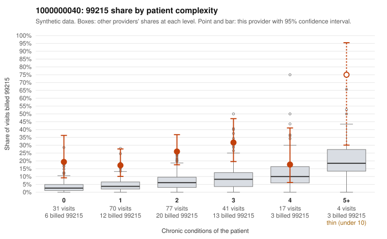

# 1000000040: 1000000040: too few returned records to judge

**Leaning (advisory):** Inconclusive

## Why

1000000040 billed 99215 on 23.8% of 240 claims against an expected 5.2% given patient complexity (risk-adjusted score 5.16; plain z-score vs peers 3.43). 32% of this provider's 99215 claims were on patients with 0 or 1 chronic conditions. Records came back for 28 claims. Of 9 documented 99215 claims, 0 (0%) were documented below the billed level, against 43% for the comparison providers. Note checks on 28 returned notes (share showing each sign): problems 25%, late 11%, unsigned 0%, data 7%. No audit trail was received. 3 of 18 notes claiming moderate-or-higher data reviewed had no lab or test line on the claim. The evidence does not support a call either way yet. Examples: C0018783: billed 99215, patient aged 42 with 0 chronic condition(s). C0018801: billed 99215, patient aged 49 with 1 chronic condition(s) (osteoarthritis).

## Evidence chart

## Cited claims

`C0018783`, `C0018801`

## Suggested next steps

- 28 charts came back but do not settle it: request a targeted sample of 99215 charts, starting with C0018783, C0018801.
- Re-check after the targeted charts arrive; do not call upcoding or a sicker panel on this evidence alone.

---
Citations checked: 2/2 valid. Synthetic data. The leaning is advisory; the flag comes from the statistical screen, and no clinical documentation is available beyond the sampled records-review facts shown in the packet.
