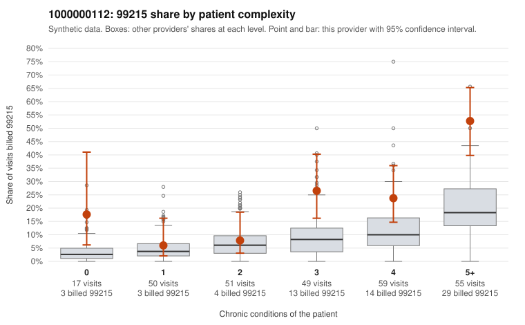

# 1000000112: 1000000112: documented 99215 claims mostly support the level billed (11% below)

**Leaning (advisory):** Pattern consistent with a high-acuity panel

## Why

1000000112 billed 99215 on 23.5% of 281 claims against an expected 8.4% given patient complexity (risk-adjusted score 3.62; plain z-score vs peers 3.37). 9% of this provider's 99215 claims were on patients with 0 or 1 chronic conditions. Records came back for 45 claims. Of 18 documented 99215 claims, 2 (11%) were documented below the billed level, against 43% for the comparison providers. Note checks on 45 returned notes (share showing each sign): problems 4%, late 9%, unsigned 0%, data 4%. No audit trail was received. 4 of 32 notes claiming moderate-or-higher data reviewed had no lab or test line on the claim. This pattern is consistent with a high-acuity panel. The sampled documentation supports the billed level. Examples: C0055129: billed 99215; documented MDM level high, minutes not recorded. C0055145: billed 99215; documented MDM level high, 39 minutes. C0055219: billed 99215; documented MDM level high, 52 minutes. C0055112: billed 99215, patient aged 44 with 4 chronic condition(s) (type 2 diabetes;obesity;hyperlipidemia;atrial fibrillation). C0055118: billed 99215, patient aged 51 with 4 chronic condition(s) (hypothyroidism;type 2 diabetes;hyperlipidemia;COPD).

## Evidence chart

## Cited claims

`C0055129`, `C0055145`, `C0055219`, `C0055112`, `C0055118`

## Suggested next steps

- Do not pursue recovery on this evidence: 45 charts came back and they support the level billed (2 of 18 documented 99215 claims below the billed level).
- Revisit if the 99215 share keeps rising against peers or a larger sample shows unsupported claims.

---
Citations checked: 5/5 valid. Synthetic data. The leaning is advisory; the flag comes from the statistical screen, and no clinical documentation is available beyond the sampled records-review facts shown in the packet.
