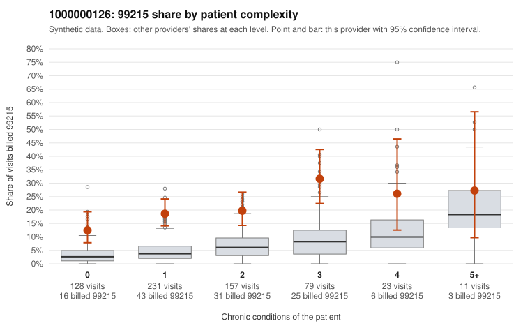

# 1000000126: 1000000126: 18 of 23 documented 99215 claims (78%) are documented below the billed level

**Leaning (advisory):** Pattern consistent with upcoding

## Why

1000000126 billed 99215 on 19.7% of 629 claims against an expected 4.7% given patient complexity (risk-adjusted score 7.23; plain z-score vs peers 2.62). 48% of this provider's 99215 claims were on patients with 0 or 1 chronic conditions. Records came back for 45 claims. Of 23 documented 99215 claims, 18 (78%) were documented below the billed level, against 43% for the comparison providers. Note checks on 45 returned notes (share showing each sign): problems 38%, late 7%, unsigned 0%, data 2%. No audit trail was received. 2 of 26 notes claiming moderate-or-higher data reviewed had no lab or test line on the claim. This pattern is consistent with upcoding. It is a reason to review the records, not a finding. Examples: C0063719: billed 99215; documented MDM level moderate, minutes not recorded. C0064176: billed 99215, patient aged 35 with 0 chronic condition(s); documented MDM level moderate, minutes not recorded. C0064267: billed 99215; documented MDM level moderate, minutes not recorded. C0063729: billed 99215, patient aged 38 with 1 chronic condition(s) (COPD). C0063730: billed 99215, patient aged 46 with 0 chronic condition(s). C0063754: billed 99215, patient aged 30 with 1 chronic condition(s) (heart failure).

## Evidence chart

## Cited claims

`C0063719`, `C0064176`, `C0064267`, `C0063729`, `C0063730`, `C0063754`

## Suggested next steps

- Request the full charts for C0063719, C0064176, C0064267 and have a certified coder re-score each against the current E/M rules (medical decision making or total time).
- If the re-scoring confirms the pattern, review the random sample in the recovery packet's sampling plan before any overpayment estimate; do not extrapolate from a targeted sample.
- Look at the notes themselves: 38% address fewer problems than their level implies and 7% were signed late; request the audit trail for C0063719, C0064176, C0064267.

---
Citations checked: 6/6 valid. Synthetic data. The leaning is advisory; the flag comes from the statistical screen, and no clinical documentation is available beyond the sampled records-review facts shown in the packet.
