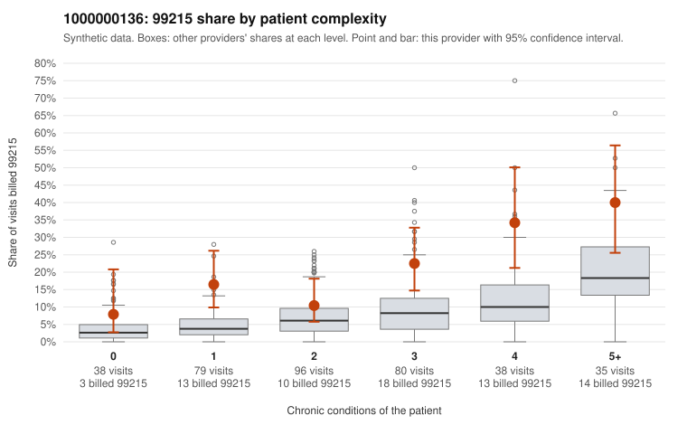

# 1000000136: 1000000136: too few returned records to judge

**Leaning (advisory):** Inconclusive

## Why

1000000136 billed 99215 on 19.4% of 366 claims against an expected 6.7% given patient complexity (risk-adjusted score 3.91; plain z-score vs peers 2.56). 23% of this provider's 99215 claims were on patients with 0 or 1 chronic conditions. Records came back for 29 claims. Of 6 documented 99215 claims, 2 (33%) were documented below the billed level, against 43% for the comparison providers. Note checks on 29 returned notes (share showing each sign): problems 7%, late 7%, unsigned 0%, data 0%. No audit trail was received. 2 of 23 notes claiming moderate-or-higher data reviewed had no lab or test line on the claim. The evidence does not support a call either way yet. Examples: C0068311: billed 99215; documented MDM level moderate, 38 minutes. C0068596: billed 99215; documented MDM level moderate, minutes not recorded. C0068306: billed 99215, patient aged 38 with 1 chronic condition(s) (obesity). C0068321: billed 99215, patient aged 44 with 1 chronic condition(s) (asthma).

## Evidence chart

## Cited claims

`C0068311`, `C0068596`, `C0068306`, `C0068321`

## Suggested next steps

- 29 charts came back but do not settle it: request a targeted sample of 99215 charts, starting with C0068311, C0068596, C0068306.
- Re-check after the targeted charts arrive; do not call upcoding or a sicker panel on this evidence alone.

---
Citations checked: 4/4 valid. Synthetic data. The leaning is advisory; the flag comes from the statistical screen, and no clinical documentation is available beyond the sampled records-review facts shown in the packet.
