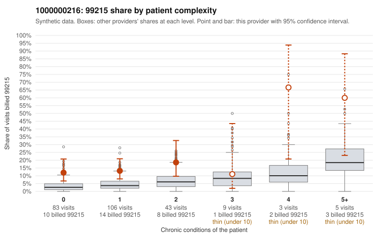

# 1000000216: 1000000216: too few returned records to judge

**Leaning (advisory):** Inconclusive

## Why

1000000216 billed 99215 on 15.3% of 249 claims against an expected 4.0% given patient complexity (risk-adjusted score 3.62; plain z-score vs peers 1.73). 63% of this provider's 99215 claims were on patients with 0 or 1 chronic conditions. Records came back for 45 claims. Of 17 documented 99215 claims, 3 (18%) were documented below the billed level, against 43% for the comparison providers. Note checks on 45 returned notes (share showing each sign): problems 40%, late 4%, unsigned 0%, data 7%. No audit trail was received. 4 of 37 notes claiming moderate-or-higher data reviewed had no lab or test line on the claim. The evidence does not support a call either way yet. Examples: C0109834: billed 99215, patient aged 69 with 1 chronic condition(s) (hypertension); documented MDM level moderate, 32 minutes. C0109892: billed 99215, patient aged 36 with 1 chronic condition(s) (obesity); documented MDM level moderate, 30 minutes. C0109740: billed 99215, patient aged 31 with 0 chronic condition(s). C0109744: billed 99215, patient aged 46 with 1 chronic condition(s) (obesity).

## Evidence chart

## Cited claims

`C0109834`, `C0109892`, `C0109740`, `C0109744`

## Suggested next steps

- 45 charts came back but do not settle it: request a targeted sample of 99215 charts, starting with C0109834, C0109892, C0109740.
- Re-check after the targeted charts arrive; do not call upcoding or a sicker panel on this evidence alone.

---
Citations checked: 4/4 valid. Synthetic data. The leaning is advisory; the flag comes from the statistical screen, and no clinical documentation is available beyond the sampled records-review facts shown in the packet.
