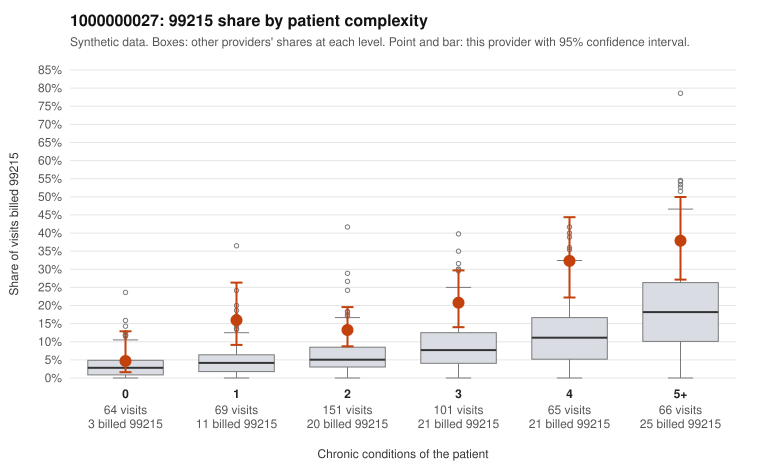

# 1000000027: 1000000027: documented 99215 claims mostly support the level billed (0% below)

**Leaning (advisory):** Pattern consistent with a high-acuity panel

## Why

1000000027 billed 99215 on 19.6% of 516 claims against an expected 6.7% given patient complexity (risk-adjusted score 5.00; plain z-score vs peers 2.69). 14% of this provider's 99215 claims were on patients with 0 or 1 chronic conditions. Records came back for 30 claims. Of 6 documented 99215 claims, 0 (0%) were documented below the billed level, against 36% for the comparison providers. Note checks on 30 returned notes (share showing each sign): problems 13%, late 3%, unsigned 0%, data 3%. No audit trail was received. 3 of 24 notes claiming moderate-or-higher data reviewed had no lab or test line on the claim. This pattern is consistent with a high-acuity panel. The sampled documentation supports the billed level. Examples: C0008936: billed 99215; documented MDM level high, 51 minutes. C0009006: billed 99215; documented MDM level high, 50 minutes. C0009198: billed 99215; documented MDM level high, minutes not recorded. C0008954: billed 99215, patient aged 41 with 4 chronic condition(s) (hyperlipidemia;depression;osteoarthritis;chronic kidney disease). C0009076: billed 99215, patient aged 42 with 5 chronic condition(s) (type 2 diabetes;obesity;hyperlipidemia;depression;hypertension).

## Evidence chart

## Cited claims

`C0008936`, `C0009006`, `C0009198`, `C0008954`, `C0009076`

## Suggested next steps

- Do not pursue recovery on this evidence: 30 charts came back and they support the level billed (0 of 6 documented 99215 claims below the billed level).
- Revisit if the 99215 share keeps rising against peers or a larger sample shows unsupported claims.

---
Citations checked: 5/5 valid. Synthetic data. The leaning is advisory; the flag comes from the statistical screen, and no clinical documentation is available beyond the sampled records-review facts shown in the packet.
