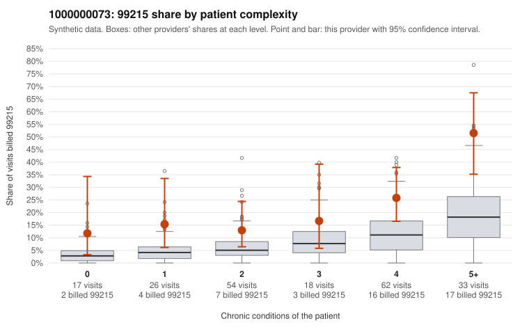

# 1000000073: 1000000073: too few returned records to judge

**Leaning (advisory):** Inconclusive

## Why

1000000073 billed 99215 on 23.3% of 210 claims against an expected 7.6% given patient complexity (risk-adjusted score 3.57; plain z-score vs peers 3.44). 12% of this provider's 99215 claims were on patients with 0 or 1 chronic conditions. Records came back for 29 claims. Of 13 documented 99215 claims, 2 (15%) were documented below the billed level, against 36% for the comparison providers. Note checks on 29 returned notes (share showing each sign): problems 14%, late 3%, unsigned 0%, data 0%. No audit trail was received. 0 of 18 notes claiming moderate-or-higher data reviewed had no lab or test line on the claim. The evidence does not support a call either way yet. Examples: C0031454: billed 99215; documented MDM level moderate, 37 minutes. C0031568: billed 99215; documented MDM level moderate, 23 minutes. C0031462: billed 99215, patient aged 63 with 1 chronic condition(s) (chronic kidney disease). C0031490: billed 99215, patient aged 56 with 0 chronic condition(s).

## Evidence chart

## Cited claims

`C0031454`, `C0031568`, `C0031462`, `C0031490`

## Suggested next steps

- 29 charts came back but do not settle it: request a targeted sample of 99215 charts, starting with C0031454, C0031568, C0031462.
- Re-check after the targeted charts arrive; do not call upcoding or a sicker panel on this evidence alone.

---
Citations checked: 4/4 valid. Synthetic data. The leaning is advisory; the flag comes from the statistical screen, and no clinical documentation is available beyond the sampled records-review facts shown in the packet.
