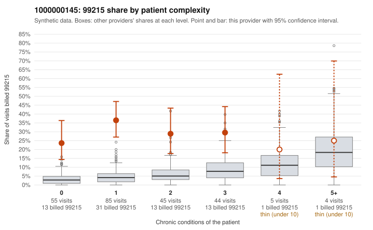

# 1000000145: 1000000145: 14 of 16 documented 99215 claims (88%) are documented below the billed level

**Leaning (advisory):** Pattern consistent with upcoding

## Why

1000000145 billed 99215 on 30.3% of 238 claims against an expected 4.4% given patient complexity (risk-adjusted score 8.38; plain z-score vs peers 4.84). 61% of this provider's 99215 claims were on patients with 0 or 1 chronic conditions. Records came back for 21 claims. Of 16 documented 99215 claims, 14 (88%) were documented below the billed level, against 36% for the comparison providers. Note checks on 21 returned notes (share showing each sign): problems 33%, late 5%, unsigned 0%, data 5%. No audit trail was received. 2 of 19 notes claiming moderate-or-higher data reviewed had no lab or test line on the claim. This pattern is consistent with upcoding. It is a reason to review the records, not a finding. Examples: C0058815: billed 99215; documented MDM level moderate, minutes not recorded. C0058838: billed 99215, patient aged 59 with 1 chronic condition(s) (type 2 diabetes); documented MDM level moderate, 31 minutes. C0058877: billed 99215, patient aged 45 with 1 chronic condition(s) (depression); documented MDM level moderate, minutes not recorded. C0058790: billed 99215, patient aged 59 with 1 chronic condition(s) (osteoarthritis). C0058800: billed 99215, patient aged 44 with 0 chronic condition(s). C0058826: billed 99215, patient aged 39 with 0 chronic condition(s).

## Evidence chart

## Cited claims

`C0058815`, `C0058838`, `C0058877`, `C0058790`, `C0058800`, `C0058826`

## Suggested next steps

- Request the full charts for C0058815, C0058838, C0058877 and have a certified coder re-score each against the current E/M rules (medical decision making or total time).
- If the re-scoring confirms the pattern, review the random sample in the recovery packet's sampling plan before any overpayment estimate; do not extrapolate from a targeted sample.
- Look at the notes themselves: 33% address fewer problems than their level implies and 5% were signed late; request the audit trail for C0058815, C0058838, C0058877.

---
Citations checked: 6/6 valid. Synthetic data. The leaning is advisory; the flag comes from the statistical screen, and no clinical documentation is available beyond the sampled records-review facts shown in the packet.
