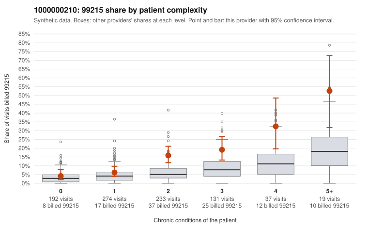

# 1000000210: 1000000210: documented 99215 claims mostly support the level billed (12% below)

**Leaning (advisory):** Pattern consistent with a high-acuity panel

## Why

1000000210 billed 99215 on 12.3% of 886 claims against an expected 4.5% given patient complexity (risk-adjusted score 4.65; plain z-score vs peers 1.22). 23% of this provider's 99215 claims were on patients with 0 or 1 chronic conditions. Records came back for 45 claims. Of 16 documented 99215 claims, 2 (12%) were documented below the billed level, against 36% for the comparison providers. Note checks on 45 returned notes (share showing each sign): problems 13%, late 7%, unsigned 0%, data 0%. No audit trail was received. 1 of 26 notes claiming moderate-or-higher data reviewed had no lab or test line on the claim. This pattern is consistent with a high-acuity panel. The sampled documentation supports the billed level. Examples: C0094622: billed 99215, patient aged 76 with 4 chronic condition(s) (obesity;hyperlipidemia;atrial fibrillation;heart failure); documented MDM level high, 40 minutes. C0094717: billed 99215, patient aged 70 with 1 chronic condition(s) (depression); documented MDM level high, 44 minutes. C0095049: billed 99215; documented MDM level high, minutes not recorded. C0094386: billed 99215, patient aged 84 with 5 chronic condition(s) (type 2 diabetes;obesity;depression;hypertension;osteoarthritis). C0094503: billed 99215, patient aged 26 with 5 chronic condition(s) (type 2 diabetes;obesity;hyperlipidemia;atrial fibrillation;COPD).

## Evidence chart

## Cited claims

`C0094622`, `C0094717`, `C0095049`, `C0094386`, `C0094503`

## Suggested next steps

- Do not pursue recovery on this evidence: 45 charts came back and they support the level billed (2 of 16 documented 99215 claims below the billed level).
- Revisit if the 99215 share keeps rising against peers or a larger sample shows unsupported claims.

---
Citations checked: 5/5 valid. Synthetic data. The leaning is advisory; the flag comes from the statistical screen, and no clinical documentation is available beyond the sampled records-review facts shown in the packet.
