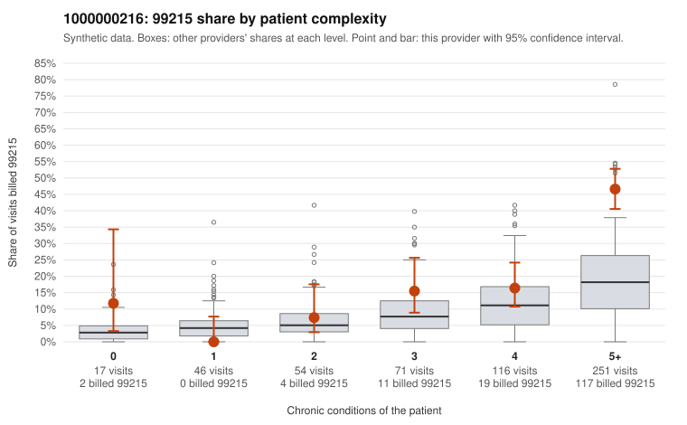

# 1000000216: 1000000216: documented 99215 claims mostly support the level billed (11% below)

**Leaning (advisory):** Pattern consistent with a high-acuity panel

## Why

1000000216 billed 99215 on 27.6% of 555 claims against an expected 10.7% given patient complexity (risk-adjusted score 5.45; plain z-score vs peers 4.30). 1% of this provider's 99215 claims were on patients with 0 or 1 chronic conditions. Records came back for 43 claims. Of 18 documented 99215 claims, 2 (11%) were documented below the billed level, against 36% for the comparison providers. Note checks on 43 returned notes (share showing each sign): problems 7%, late 9%, unsigned 0%, data 2%. No audit trail was received. 2 of 35 notes claiming moderate-or-higher data reviewed had no lab or test line on the claim. This pattern is consistent with a high-acuity panel. The sampled documentation supports the billed level. Examples: C0097409: billed 99215; documented MDM level high, 41 minutes. C0097850: billed 99215; documented MDM level high, 42 minutes. C0097879: billed 99215; documented MDM level high, minutes not recorded. C0097445: billed 99215, patient aged 85 with 5 chronic condition(s) (hyperlipidemia;hypertension;atrial fibrillation;COPD;osteoarthritis). C0097566: billed 99215, patient aged 59 with 4 chronic condition(s) (type 2 diabetes;obesity;hypertension;COPD).

## Evidence chart

## Cited claims

`C0097409`, `C0097850`, `C0097879`, `C0097445`, `C0097566`

## Suggested next steps

- Do not pursue recovery on this evidence: 43 charts came back and they support the level billed (2 of 18 documented 99215 claims below the billed level).
- Revisit if the 99215 share keeps rising against peers or a larger sample shows unsupported claims.

---
Citations checked: 5/5 valid. Synthetic data. The leaning is advisory; the flag comes from the statistical screen, and no clinical documentation is available beyond the sampled records-review facts shown in the packet.
