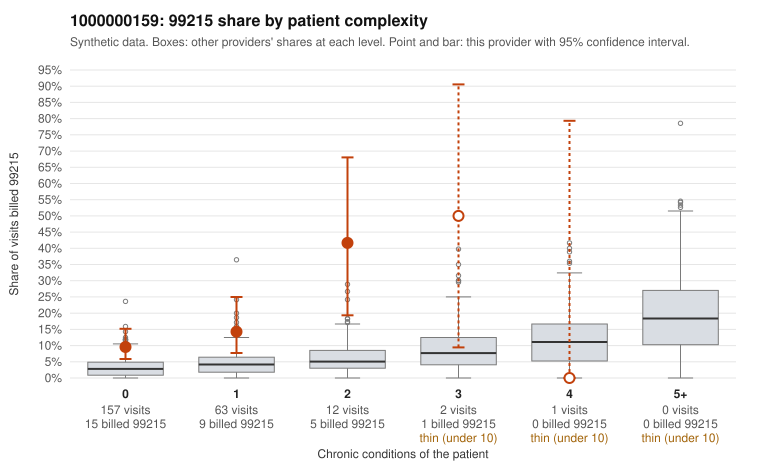

# Payment Integrity dossier: 1000000159

> Draft for human review. Statistical and records-sample evidence only; not a finding. Compliance or legal review is needed before any provider contact, notice or recoupment.

## Provider overview

| | |
|---|---|
| Specialty / state | Family Practice, GA (synthetic) |
| Claims / patients | 235 / 106 |
| Billed mix (99211 to 99215) | 1 / 7 / 89 / 108 / 30 |
| 99215 share | 12.8% |
| Expected 99215 share given patient complexity | 2.8% |
| Screen scores | z vs peers 1.31; risk-adjusted 3.84; flagged by eb_ratio |

## Case summary (advisory)

**Provider 1000000159's 99215 billing is concentrated on low-complexity patients, and most documented 99215 claims do not support the billed level, a pattern consistent with upcoding.**

Leaning: pattern consistent with upcoding. Citations checked: 6/6 valid.

1000000159 billed 99215 on 12.8% of 235 claims against an expected 2.8% given patient complexity (risk-adjusted score 3.84; plain z-score vs peers 1.31). 80% of this provider's 99215 claims were on patients with 0 or 1 chronic conditions. Records came back for 45 claims. Of 20 documented 99215 claims, 15 (75%) were documented below the billed level, against 36% for the comparison providers. Note checks on 45 returned notes (share showing each sign): problems 38%, late 0%, unsigned 0%, data 9%, bulk created 0%, paste heavy 0%. 7 of 26 notes claiming moderate-or-higher data reviewed had no lab or test line on the claim. The excess 99215 share is not explained by panel acuity: the 99215s fall mostly on patients with zero or one chronic condition. The sampled claims show routine diagnoses such as J06.9, R21 and M54.50 (e.g., C0066216, C0066235, C0066386). The documentation is the stronger signal. Among documented 99215 claims the below-billed rate is about double the comparison rate, and 99214 claims also show elevated mismatch (e.g., C0066277 and C0066383 documented only at moderate MDM). Ambiguity remains: a few low-complexity 99215s are documented at high MDM (C0066270, C0066311 with 46-52 minutes), and records cover only about a fifth of claims. The high duplicate-note rate and the notes claiming moderate-plus data review without a corresponding lab or test line also raise the possibility that even the supporting notes are cloned or inflated, which is weak evidence rather than proof. A reviewer should first compare the supported 99215 notes against the duplicate-note and time-repeat flags to test whether that documentation is templated. They should then request additional charts to confirm the unsupported rate on a larger sample. Examples: C0066277: billed 99215, patient aged 32 with 1 chronic condition(s) (hyperlipidemia); documented MDM level moderate, 30 minutes. C0066364: billed 99215; documented MDM level moderate, 37 minutes. C0066383: billed 99215, patient aged 40 with 0 chronic condition(s); documented MDM level moderate, 33 minutes. C0066179: billed 99215, patient aged 49 with 1 chronic condition(s) (chronic kidney disease). C0066187: billed 99215, patient aged 74 with 1 chronic condition(s) (COPD); documented MDM level high, minutes not recorded. C0066216: billed 99215, patient aged 74 with 0 chronic condition(s).

## Evidence chart

## Records-review sample so far

Documentation is on file for 45 claims (19% of this provider's claims).

| Billed | Documented | Documentation below billed level | Rate | All-provider rate |
|---|---|---|---|---|
| 99213 | 14 | 2 | 14.3% | 5.5% |
| 99214 | 10 | 3 | 30.0% | 8.1% |
| 99215 | 20 | 15 | 75.0% | 35.5% |

## Recommended next steps for Payment Integrity

1. Request records for the sampled claims in `record_request_list.csv` (30 claims across 99215).
2. Review the records against E/M documentation rules and record the supported level for each claim.
3. Run the overpayment estimator on the reviewed sample (`sampling_plan.md` explains how).
4. Notice, appeal rights, recoupment, education or corrective action, and any referral are decisions for the PI team, compliance and counsel. Nothing here drafts those.

Suggested follow-ups from the case summary:

- Request the full charts for C0066277, C0066364, C0066383 and have a certified coder re-score each against the current E/M rules (medical decision making or total time).
- If the re-scoring confirms the pattern, review the random sample in the recovery packet's sampling plan before any overpayment estimate; do not extrapolate from a targeted sample.
- Look at the notes themselves: 38% address fewer problems than their level implies and 0% were signed late; request the audit trail for C0066277, C0066364, C0066383.

## Limits

- Synthetic data; no real claims or providers.
- The leaning is advisory. The flag comes from the statistical screen; the summary explains it.
- The records-review sample is partial and was simulated for this project.
- Allowed amounts are GA Family Practice averages from a public CMS file, not this provider's actual payments.
