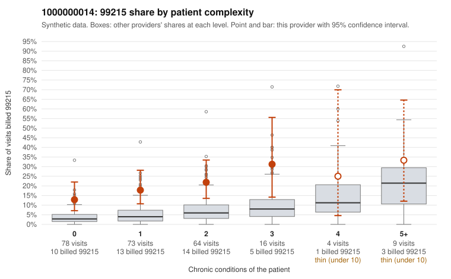

# 1000000014: 1000000014: too few returned records to judge

**Leaning (advisory):** Inconclusive

## Why

1000000014 billed 99215 on 18.9% of 244 claims against an expected 4.8% given patient complexity (risk-adjusted score 3.92; plain z-score vs peers 1.67). 50% of this provider's 99215 claims were on patients with 0 or 1 chronic conditions. Records came back for 45 claims. Of 19 documented 99215 claims, 0 (0%) were documented below the billed level, against 29% for the comparison providers. Note checks on 45 returned notes (share showing each sign): problems 29%, late 29%, unsigned 0%, data 16%. No audit trail was received. 7 of 33 notes claiming moderate-or-higher data reviewed had no lab or test line on the claim. The evidence does not support a call either way yet. Examples: C0005275: billed 99215, patient aged 61 with 1 chronic condition(s) (asthma). C0005278: billed 99215, patient aged 40 with 1 chronic condition(s) (type 2 diabetes).

## Evidence chart

## Cited claims

`C0005275`, `C0005278`

## Suggested next steps

- 45 charts came back but do not settle it: request a targeted sample of 99215 charts, starting with C0005275, C0005278.
- Re-check after the targeted charts arrive; do not call upcoding or a sicker panel on this evidence alone.

---
Citations checked: 2/2 valid. Synthetic data. The leaning is advisory; the flag comes from the statistical screen, and no clinical documentation is available beyond the sampled records-review facts shown in the packet.
