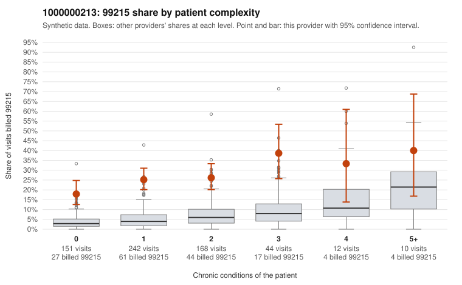

# 1000000213: 1000000213: 0 of 6 documented 99215 claims (0%) are documented below the billed level

**Leaning (advisory):** Pattern consistent with upcoding

## Why

1000000213 billed 99215 on 25.0% of 627 claims against an expected 4.6% given patient complexity (risk-adjusted score 9.40; plain z-score vs peers 2.58). 56% of this provider's 99215 claims were on patients with 0 or 1 chronic conditions. Records came back for 30 claims. Of 6 documented 99215 claims, 0 (0%) were documented below the billed level, against 29% for the comparison providers. Note checks on 30 returned notes (share showing each sign): problems 40%, late 7%, unsigned 0%, data 10%, bulk created 3%, paste heavy 13%. 3 of 22 notes claiming moderate-or-higher data reviewed had no lab or test line on the claim. This pattern is consistent with upcoding. It is a reason to review the records, not a finding. Examples: C0107963: billed 99214; documented MDM level low, minutes not recorded. C0108144: billed 99214; documented MDM level low, minutes not recorded. C0107656: billed 99215, patient aged 26 with 1 chronic condition(s) (hypothyroidism). C0107705: billed 99215, patient aged 38 with 1 chronic condition(s) (heart failure). C0107759: billed 99215, patient aged 58 with 1 chronic condition(s) (hypertension).

## Evidence chart

## Cited claims

`C0107963`, `C0108144`, `C0107656`, `C0107705`, `C0107759`

## Suggested next steps

- Request the full charts for C0107963, C0108144, C0107656 and have a certified coder re-score each against the current E/M rules (medical decision making or total time).
- If the re-scoring confirms the pattern, review the random sample in the recovery packet's sampling plan before any overpayment estimate; do not extrapolate from a targeted sample.
- Look at the notes themselves: 40% address fewer problems than their level implies and 7% were signed late; request the audit trail for C0107963, C0108144, C0107656.

---
Citations checked: 5/5 valid. Synthetic data. The leaning is advisory; the flag comes from the statistical screen, and no clinical documentation is available beyond the sampled records-review facts shown in the packet.
