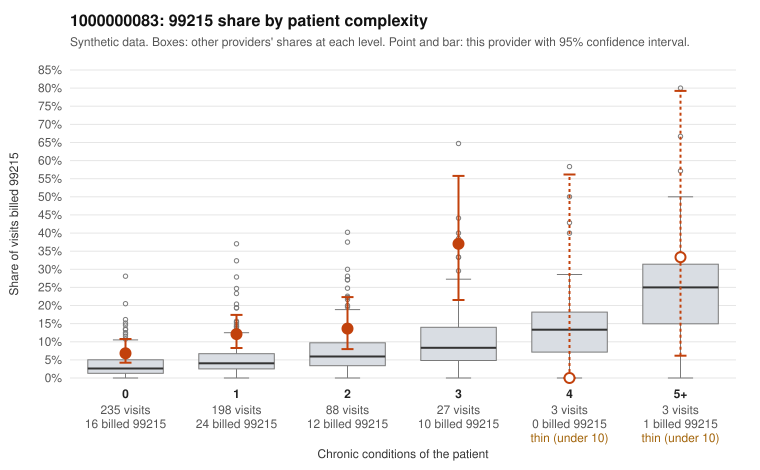

# 1000000083: 1000000083: documented 99215 claims mostly support the level billed (17% below)

**Leaning (advisory):** Pattern consistent with a high-acuity panel

## Why

1000000083 billed 99215 on 11.4% of 554 claims against an expected 4.1% given patient complexity (risk-adjusted score 3.27; plain z-score vs peers 0.76). 63% of this provider's 99215 claims were on patients with 0 or 1 chronic conditions. Records came back for 45 claims. Of 18 documented 99215 claims, 3 (17%) were documented below the billed level, against 33% for the comparison providers. Note checks on 45 returned notes (share showing each sign): problems 44%, late 7%, unsigned 0%, data 11%, bulk created 0%, paste heavy 2%. 5 of 31 notes claiming moderate-or-higher data reviewed had no lab or test line on the claim. This pattern is consistent with a high-acuity panel. The sampled documentation supports the billed level. Examples: C0046940: billed 99215, patient aged 68 with 1 chronic condition(s) (COPD); documented MDM level high, 40 minutes. C0047182: billed 99215; documented MDM level high, minutes not recorded. C0047187: billed 99215, patient aged 60 with 0 chronic condition(s); documented MDM level high, 48 minutes. C0047011: billed 99215, patient aged 66 with 5 chronic condition(s) (type 2 diabetes;obesity;hyperlipidemia;depression;hypertension).

## Evidence chart

## Cited claims

`C0046940`, `C0047182`, `C0047187`, `C0047011`

## Suggested next steps

- Do not pursue recovery on this evidence: 45 charts came back and they support the level billed (3 of 18 documented 99215 claims below the billed level).
- Revisit if the 99215 share keeps rising against peers or a larger sample shows unsupported claims.

---
Citations checked: 4/4 valid. Synthetic data. The leaning is advisory; the flag comes from the statistical screen, and no clinical documentation is available beyond the sampled records-review facts shown in the packet.
