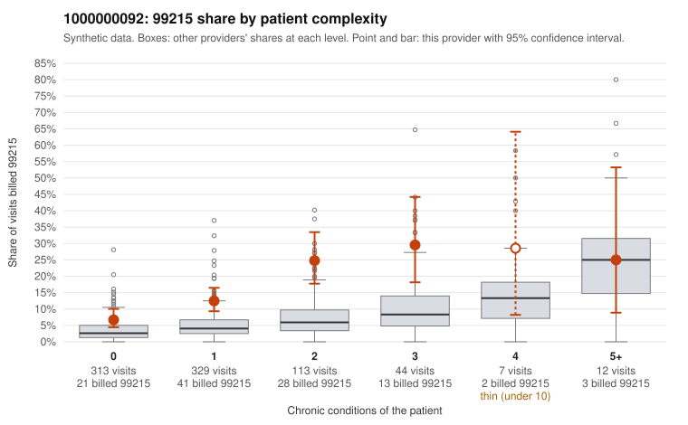

# 1000000092: 1000000092: too few returned records to judge

**Leaning (advisory):** Inconclusive

## Why

1000000092 billed 99215 on 13.2% of 818 claims against an expected 4.3% given patient complexity (risk-adjusted score 4.83; plain z-score vs peers 1.08). 57% of this provider's 99215 claims were on patients with 0 or 1 chronic conditions. Records came back for 45 claims. Of 19 documented 99215 claims, 5 (26%) were documented below the billed level, against 33% for the comparison providers. Note checks on 45 returned notes (share showing each sign): problems 33%, late 2%, unsigned 0%, data 2%. No audit trail was received. 1 of 30 notes claiming moderate-or-higher data reviewed had no lab or test line on the claim. The evidence does not support a call either way yet. Examples: C0051654: billed 99215; documented MDM level moderate, 39 minutes. C0051698: billed 99215; documented MDM level moderate, minutes not recorded. C0051377: billed 99215, patient aged 50 with 1 chronic condition(s) (hypertension). C0051392: billed 99215, patient aged 46 with 1 chronic condition(s) (hyperlipidemia).

## Evidence chart

## Cited claims

`C0051654`, `C0051698`, `C0051377`, `C0051392`

## Suggested next steps

- 45 charts came back but do not settle it: request a targeted sample of 99215 charts, starting with C0051654, C0051698, C0051377.
- Re-check after the targeted charts arrive; do not call upcoding or a sicker panel on this evidence alone.

---
Citations checked: 4/4 valid. Synthetic data. The leaning is advisory; the flag comes from the statistical screen, and no clinical documentation is available beyond the sampled records-review facts shown in the packet.
