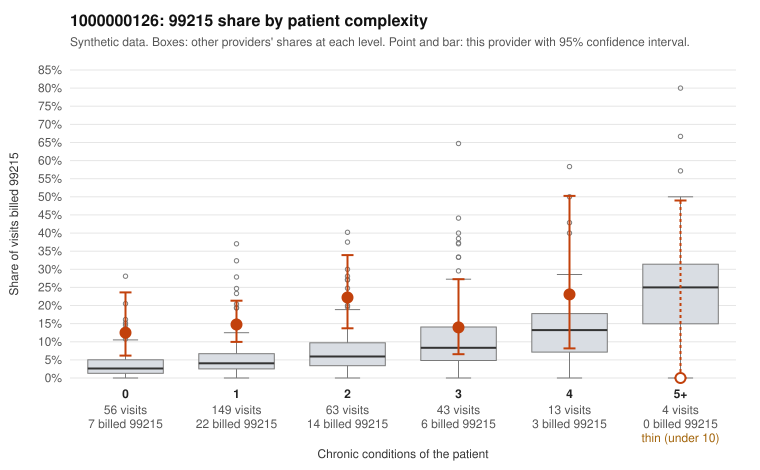

# 1000000126: 1000000126: too few returned records to judge

**Leaning (advisory):** Inconclusive

## Why

1000000126 billed 99215 on 15.9% of 328 claims against an expected 5.1% given patient complexity (risk-adjusted score 3.37; plain z-score vs peers 1.54). 56% of this provider's 99215 claims were on patients with 0 or 1 chronic conditions. Records came back for 45 claims. Of 19 documented 99215 claims, 5 (26%) were documented below the billed level, against 33% for the comparison providers. Note checks on 45 returned notes (share showing each sign): problems 29%, late 4%, unsigned 0%, data 4%. No audit trail was received. 3 of 34 notes claiming moderate-or-higher data reviewed had no lab or test line on the claim. The evidence does not support a call either way yet. Examples: C0069786: billed 99215, patient aged 41 with 0 chronic condition(s); documented MDM level moderate, minutes not recorded. C0069893: billed 99215; documented MDM level moderate, 23 minutes. C0069694: billed 99215, patient aged 65 with 1 chronic condition(s) (atrial fibrillation); documented MDM level high, minutes not recorded. C0069722: billed 99215, patient aged 60 with 0 chronic condition(s).

## Evidence chart

## Cited claims

`C0069786`, `C0069893`, `C0069694`, `C0069722`

## Suggested next steps

- 45 charts came back but do not settle it: request a targeted sample of 99215 charts, starting with C0069786, C0069893, C0069694.
- Re-check after the targeted charts arrive; do not call upcoding or a sicker panel on this evidence alone.

---
Citations checked: 4/4 valid. Synthetic data. The leaning is advisory; the flag comes from the statistical screen, and no clinical documentation is available beyond the sampled records-review facts shown in the packet.
