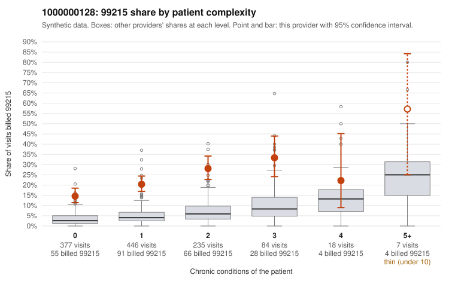

# 1000000128: 1000000128: too few returned records to judge

**Leaning (advisory):** Inconclusive

## Why

1000000128 billed 99215 on 21.3% of 1,167 claims against an expected 4.4% given patient complexity (risk-adjusted score 10.82; plain z-score vs peers 2.49). 59% of this provider's 99215 claims were on patients with 0 or 1 chronic conditions. Records came back for 30 claims. Of 6 documented 99215 claims, 2 (33%) were documented below the billed level, against 33% for the comparison providers. Note checks on 30 returned notes (share showing each sign): problems 43%, late 0%, unsigned 0%, data 10%, bulk created 0%, paste heavy 0%. 5 of 23 notes claiming moderate-or-higher data reviewed had no lab or test line on the claim. The evidence does not support a call either way yet. Examples: C0070814: billed 99215; documented MDM level moderate, minutes not recorded. C0071782: billed 99215, patient aged 66 with 1 chronic condition(s) (hypertension); documented MDM level moderate, 21 minutes. C0070719: billed 99215, patient aged 66 with 0 chronic condition(s). C0070743: billed 99215, patient aged 40 with 1 chronic condition(s) (depression).

## Evidence chart

## Cited claims

`C0070814`, `C0071782`, `C0070719`, `C0070743`

## Suggested next steps

- 30 charts came back but do not settle it: request a targeted sample of 99215 charts, starting with C0070814, C0071782, C0070719.
- Re-check after the targeted charts arrive; do not call upcoding or a sicker panel on this evidence alone.

---
Citations checked: 4/4 valid. Synthetic data. The leaning is advisory; the flag comes from the statistical screen, and no clinical documentation is available beyond the sampled records-review facts shown in the packet.
