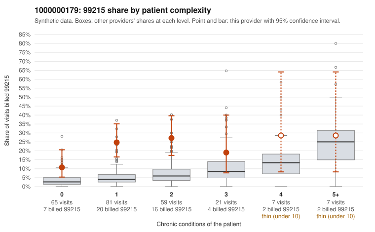

# 1000000179: 1000000179: too few returned records to judge

**Leaning (advisory):** Inconclusive

## Why

1000000179 billed 99215 on 21.2% of 240 claims against an expected 5.1% given patient complexity (risk-adjusted score 4.39; plain z-score vs peers 2.49). 53% of this provider's 99215 claims were on patients with 0 or 1 chronic conditions. Records came back for 29 claims. Of 3 documented 99215 claims, 0 (0%) were documented below the billed level, against 33% for the comparison providers. Note checks on 29 returned notes (share showing each sign): problems 28%, late 7%, unsigned 0%, data 10%. No audit trail was received. 3 of 13 notes claiming moderate-or-higher data reviewed had no lab or test line on the claim. The evidence does not support a call either way yet. Examples: C0097710: billed 99213; documented MDM level straightforward, minutes not recorded. C0097694: billed 99215, patient aged 24 with 0 chronic condition(s). C0097702: billed 99215, patient aged 34 with 1 chronic condition(s) (type 2 diabetes).

## Evidence chart

## Cited claims

`C0097710`, `C0097694`, `C0097702`

## Suggested next steps

- 29 charts came back but do not settle it: request a targeted sample of 99215 charts, starting with C0097710, C0097694, C0097702.
- Re-check after the targeted charts arrive; do not call upcoding or a sicker panel on this evidence alone.

---
Citations checked: 3/3 valid. Synthetic data. The leaning is advisory; the flag comes from the statistical screen, and no clinical documentation is available beyond the sampled records-review facts shown in the packet.
