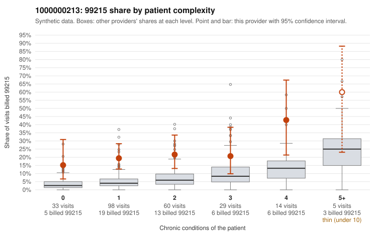

# 1000000213: 1000000213: too few returned records to judge

**Leaning (advisory):** Inconclusive

## Why

1000000213 billed 99215 on 21.8% of 239 claims against an expected 5.4% given patient complexity (risk-adjusted score 4.26; plain z-score vs peers 2.58). 46% of this provider's 99215 claims were on patients with 0 or 1 chronic conditions. Records came back for 29 claims. Of 6 documented 99215 claims, 1 (17%) were documented below the billed level, against 33% for the comparison providers. Note checks on 29 returned notes (share showing each sign): problems 28%, late 10%, unsigned 0%, data 10%. No audit trail was received. 3 of 22 notes claiming moderate-or-higher data reviewed had no lab or test line on the claim. The evidence does not support a call either way yet. Examples: C0109203: billed 99215; documented MDM level moderate, minutes not recorded. C0109022: billed 99215, patient aged 47 with 0 chronic condition(s). C0109034: billed 99215, patient aged 69 with 1 chronic condition(s) (obesity); documented MDM level high, 50 minutes.

## Evidence chart

## Cited claims

`C0109203`, `C0109022`, `C0109034`

## Suggested next steps

- 29 charts came back but do not settle it: request a targeted sample of 99215 charts, starting with C0109203, C0109022, C0109034.
- Re-check after the targeted charts arrive; do not call upcoding or a sicker panel on this evidence alone.

---
Citations checked: 3/3 valid. Synthetic data. The leaning is advisory; the flag comes from the statistical screen, and no clinical documentation is available beyond the sampled records-review facts shown in the packet.
