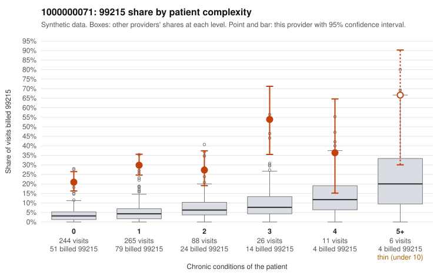

# 1000000071: 1000000071: too few returned records to judge

**Leaning (advisory):** Inconclusive

## Why

1000000071 billed 99215 on 27.5% of 640 claims against an expected 3.9% given patient complexity (risk-adjusted score 10.58; plain z-score vs peers 3.16). 74% of this provider's 99215 claims were on patients with 0 or 1 chronic conditions. Records came back for 30 claims. Of 8 documented 99215 claims, 0 (0%) were documented below the billed level, against 29% for the comparison providers. Note checks on 30 returned notes (share showing each sign): problems 43%, late 10%, unsigned 0%, data 3%, bulk created 3%, paste heavy 3%. 1 of 20 notes claiming moderate-or-higher data reviewed had no lab or test line on the claim. The evidence does not support a call either way yet. Examples: C0042032: billed 99213; documented MDM level straightforward, minutes not recorded. C0041804: billed 99215, patient aged 51 with 1 chronic condition(s) (obesity). C0041874: billed 99215, patient aged 39 with 0 chronic condition(s).

## Evidence chart

## Cited claims

`C0042032`, `C0041804`, `C0041874`

## Suggested next steps

- 30 charts came back but do not settle it: request a targeted sample of 99215 charts, starting with C0042032, C0041804, C0041874.
- Re-check after the targeted charts arrive; do not call upcoding or a sicker panel on this evidence alone.

---
Citations checked: 3/3 valid. Synthetic data. The leaning is advisory; the flag comes from the statistical screen, and no clinical documentation is available beyond the sampled records-review facts shown in the packet.
