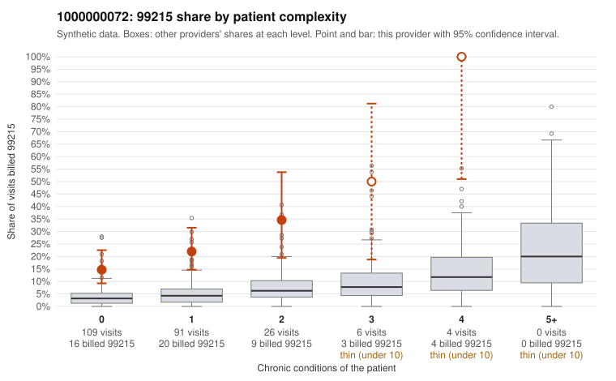

# 1000000072: 1000000072: 13 of 19 documented 99215 claims (68%) are documented below the billed level

**Leaning (advisory):** Pattern consistent with upcoding

## Why

1000000072 billed 99215 on 22.0% of 236 claims against an expected 3.6% given patient complexity (risk-adjusted score 5.12; plain z-score vs peers 2.30). 69% of this provider's 99215 claims were on patients with 0 or 1 chronic conditions. Records came back for 44 claims. Of 19 documented 99215 claims, 13 (68%) were documented below the billed level, against 29% for the comparison providers. Note checks on 44 returned notes (share showing each sign): problems 34%, late 9%, unsigned 0%, data 7%. No audit trail was received. 4 of 27 notes claiming moderate-or-higher data reviewed had no lab or test line on the claim. This pattern is consistent with upcoding. It is a reason to review the records, not a finding. Examples: C0042480: billed 99215; documented MDM level low, minutes not recorded. C0042526: billed 99215, patient aged 50 with 0 chronic condition(s); documented MDM level moderate, 38 minutes. C0042569: billed 99215, patient aged 51 with 4 chronic condition(s) (type 2 diabetes;hypertension;heart failure;COPD); documented MDM level moderate, minutes not recorded. C0042419: billed 99215, patient aged 43 with 1 chronic condition(s) (COPD). C0042425: billed 99215, patient aged 72 with 0 chronic condition(s). C0042431: billed 99215, patient aged 51 with 1 chronic condition(s) (COPD).

## Evidence chart

## Cited claims

`C0042480`, `C0042526`, `C0042569`, `C0042419`, `C0042425`, `C0042431`

## Suggested next steps

- Request the full charts for C0042480, C0042526, C0042569 and have a certified coder re-score each against the current E/M rules (medical decision making or total time).
- If the re-scoring confirms the pattern, review the random sample in the recovery packet's sampling plan before any overpayment estimate; do not extrapolate from a targeted sample.
- Look at the notes themselves: 34% address fewer problems than their level implies and 9% were signed late; request the audit trail for C0042480, C0042526, C0042569.

---
Citations checked: 6/6 valid. Synthetic data. The leaning is advisory; the flag comes from the statistical screen, and no clinical documentation is available beyond the sampled records-review facts shown in the packet.
