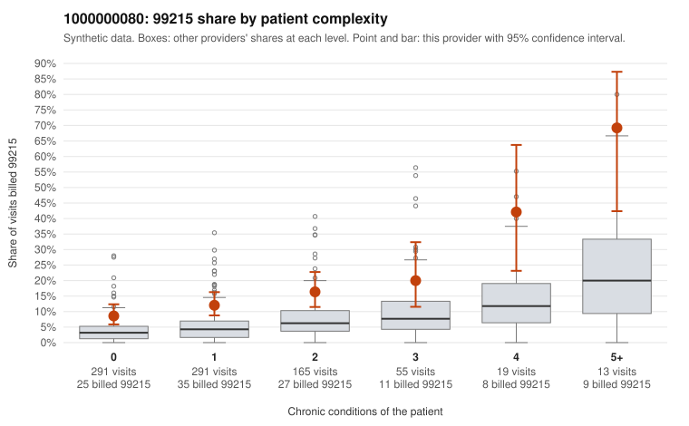

# 1000000080: 1000000080: too few returned records to judge

**Leaning (advisory):** Inconclusive

## Why

1000000080 billed 99215 on 13.8% of 834 claims against an expected 4.3% given patient complexity (risk-adjusted score 4.60; plain z-score vs peers 1.00). 52% of this provider's 99215 claims were on patients with 0 or 1 chronic conditions. Records came back for 45 claims. Of 18 documented 99215 claims, 4 (22%) were documented below the billed level, against 29% for the comparison providers. Note checks on 45 returned notes (share showing each sign): problems 36%, late 4%, unsigned 0%, data 0%, bulk created 0%, paste heavy 2%. 1 of 33 notes claiming moderate-or-higher data reviewed had no lab or test line on the claim. The evidence does not support a call either way yet. Examples: C0045191: billed 99215; documented MDM level moderate, minutes not recorded. C0045396: billed 99215; documented MDM level moderate, 32 minutes. C0044865: billed 99215, patient aged 53 with 1 chronic condition(s) (depression). C0044976: billed 99215, patient aged 35 with 0 chronic condition(s).

## Evidence chart

## Cited claims

`C0045191`, `C0045396`, `C0044865`, `C0044976`

## Suggested next steps

- 45 charts came back but do not settle it: request a targeted sample of 99215 charts, starting with C0045191, C0045396, C0044865.
- Re-check after the targeted charts arrive; do not call upcoding or a sicker panel on this evidence alone.

---
Citations checked: 4/4 valid. Synthetic data. The leaning is advisory; the flag comes from the statistical screen, and no clinical documentation is available beyond the sampled records-review facts shown in the packet.
