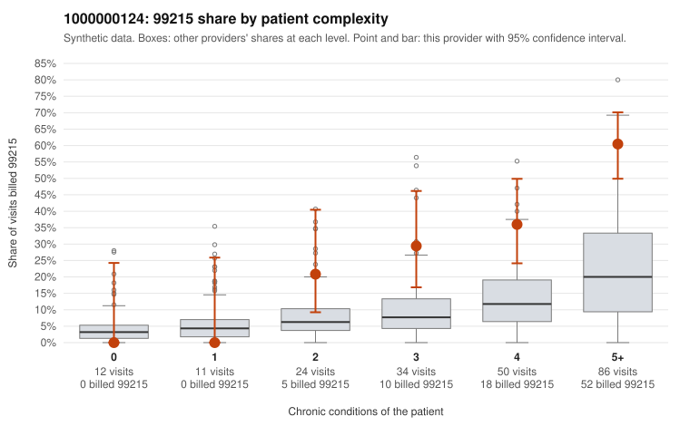

# 1000000124: 1000000124: too few returned records to judge

**Leaning (advisory):** Inconclusive

## Why

1000000124 billed 99215 on 39.2% of 217 claims against an expected 11.3% given patient complexity (risk-adjusted score 4.41; plain z-score vs peers 5.01). 0% of this provider's 99215 claims were on patients with 0 or 1 chronic conditions. Records came back for 29 claims. Of 13 documented 99215 claims, 0 (0%) were documented below the billed level, against 29% for the comparison providers. Note checks on 29 returned notes (share showing each sign): problems 0%, late 7%, unsigned 0%, data 10%. No audit trail was received. 5 of 23 notes claiming moderate-or-higher data reviewed had no lab or test line on the claim. The evidence does not support a call either way yet. Examples: C0068074: billed 99215, patient aged 61 with 5 chronic condition(s) (type 2 diabetes;atrial fibrillation;asthma;osteoarthritis;chronic kidney disease). C0068145: billed 99215, patient aged 72 with 5 chronic condition(s) (type 2 diabetes;obesity;hypertension;COPD;chronic kidney disease). C0068085: billed 99213, patient aged 44 with 0 chronic condition(s). C0068091: billed 99213, patient aged 62 with 1 chronic condition(s) (osteoarthritis).

## Evidence chart

## Cited claims

`C0068074`, `C0068145`, `C0068085`, `C0068091`

## Suggested next steps

- 29 charts came back but do not settle it: request a targeted sample of 99215 charts, starting with C0068074, C0068145, C0068085.
- Re-check after the targeted charts arrive; do not call upcoding or a sicker panel on this evidence alone.

---
Citations checked: 4/4 valid. Synthetic data. The leaning is advisory; the flag comes from the statistical screen, and no clinical documentation is available beyond the sampled records-review facts shown in the packet.
