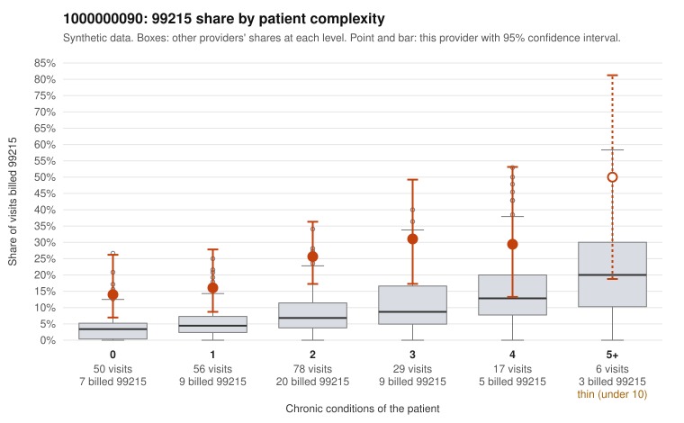

# 1000000090: Provider 1000000090 bills 99215 far above expectation in every complexity stratum, including patients with no chronic conditions, but the small set of returned charts supports the billed levels while showing signs of possible cloned or inflated notes.

**Leaning (advisory):** Inconclusive

## Why

1000000090 billed 99215 on 22.5% of 236 claims against an expected 5.8% given patient complexity (risk-adjusted score 4.04; plain z-score vs peers 2.80). 30% of this provider's 99215 claims were on patients with 0 or 1 chronic conditions. Records came back for 30 claims. Of 9 documented 99215 claims, 0 (0%) were documented below the billed level, against 21% for the comparison providers. Note checks on 30 returned notes (share showing each sign): problems 23%, late 20%, unsigned 0%, data 20%. No audit trail was received. 7 of 22 notes claiming moderate-or-higher data reviewed had no lab or test line on the claim. The billing pattern is consistent with upcoding rather than a sicker panel. The 99215 excess is not confined to complex patients: it appears at every condition count, including the 0-condition stratum. The low-complexity sample includes repeat 99215 visits for minor problems, such as patient M0016705 billed twice for rash (R21) on C0039566 and C0039573, and M0016658 billed for back pain and a UTI code on C0039473 and C0039567. Against that, none of the 9 documented 99215 claims fell below the billed level, which on its face supports the codes. That reassurance is weak for two reasons: 9 charts is a thin base, and the note signals point toward documentation that may be cloned or inflated to match. Those signals include a high duplicate-note rate, repeated visit times, data-reviewed claims with no matching lab line, and no audit trail. For example, C0039573, a rash visit on a patient with no chronic conditions, is documented as high MDM with 49 minutes, which deserves a close look. A reviewer should first pull the full charts for the low-complexity 99215 claims, starting with C0039573 and C0039566, and compare note text across visits for templated or duplicated content. They should also request the EHR audit trail and more records to widen the documented sample beyond 9 claims. Examples: C0039435: billed 99215, patient aged 49 with 1 chronic condition(s) (hypertension). C0039471: billed 99215, patient aged 42 with 1 chronic condition(s) (hypertension).

## Evidence chart

## Cited claims

`C0039435`, `C0039471`

## Suggested next steps

- 30 charts came back but do not settle it: request a targeted sample of 99215 charts, starting with C0039435, C0039471.
- Re-check after the targeted charts arrive; do not call upcoding or a sicker panel on this evidence alone.

---
Citations checked: 2/2 valid. Synthetic data. The leaning is advisory; the flag comes from the statistical screen, and no clinical documentation is available beyond the sampled records-review facts shown in the packet.
