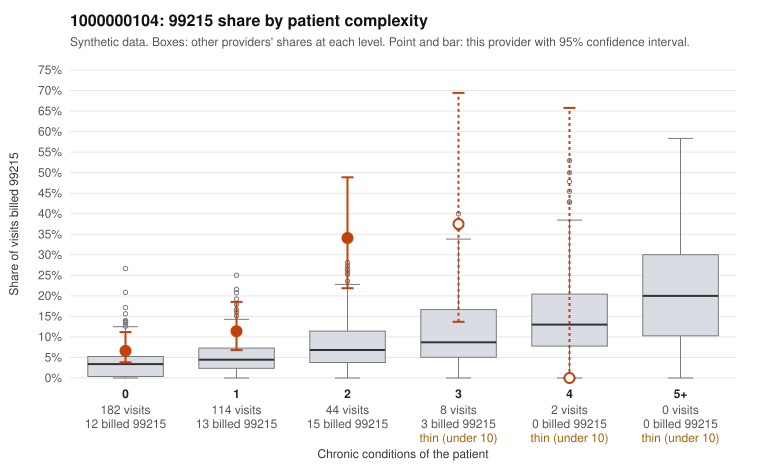

# 1000000104: 1000000104: too few returned records to judge

**Leaning (advisory):** Inconclusive

## Why

1000000104 billed 99215 on 12.3% of 350 claims against an expected 3.9% given patient complexity (risk-adjusted score 2.95; plain z-score vs peers 0.90). 58% of this provider's 99215 claims were on patients with 0 or 1 chronic conditions. Records came back for 45 claims. Of 19 documented 99215 claims, 4 (21%) were documented below the billed level, against 21% for the comparison providers. Note checks on 45 returned notes (share showing each sign): problems 49%, late 2%, unsigned 0%, data 4%, bulk created 0%, paste heavy 0%. 2 of 31 notes claiming moderate-or-higher data reviewed had no lab or test line on the claim. The evidence does not support a call either way yet. Examples: C0047233: billed 99215, patient aged 63 with 1 chronic condition(s) (type 2 diabetes); documented MDM level moderate, 39 minutes. C0047239: billed 99215, patient aged 66 with 0 chronic condition(s); documented MDM level moderate, 38 minutes. C0047154: billed 99215, patient aged 44 with 0 chronic condition(s). C0047171: billed 99215, patient aged 55 with 0 chronic condition(s).

## Evidence chart

## Cited claims

`C0047233`, `C0047239`, `C0047154`, `C0047171`

## Suggested next steps

- 45 charts came back but do not settle it: request a targeted sample of 99215 charts, starting with C0047233, C0047239, C0047154.
- Re-check after the targeted charts arrive; do not call upcoding or a sicker panel on this evidence alone.

---
Citations checked: 4/4 valid. Synthetic data. The leaning is advisory; the flag comes from the statistical screen, and no clinical documentation is available beyond the sampled records-review facts shown in the packet.
