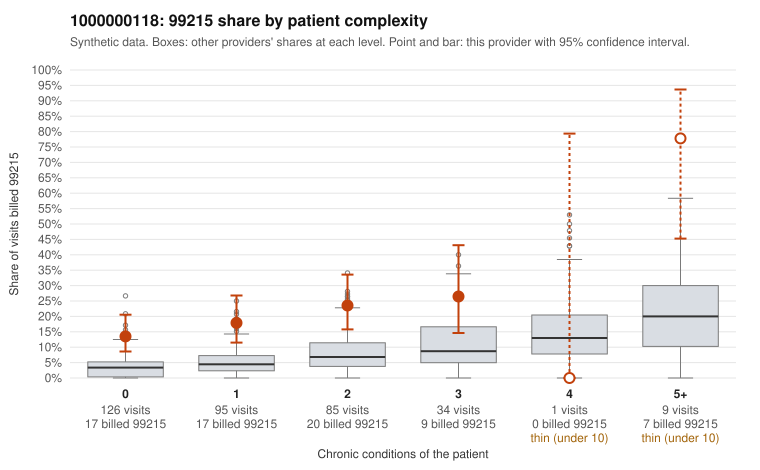

# 1000000118: 1000000118: too few returned records to judge

**Leaning (advisory):** Inconclusive

## Why

1000000118 billed 99215 on 20.0% of 350 claims against an expected 4.8% given patient complexity (risk-adjusted score 4.88; plain z-score vs peers 2.34). 49% of this provider's 99215 claims were on patients with 0 or 1 chronic conditions. Records came back for 30 claims. Of 6 documented 99215 claims, 0 (0%) were documented below the billed level, against 21% for the comparison providers. Note checks on 30 returned notes (share showing each sign): problems 27%, late 3%, unsigned 0%, data 0%. No audit trail was received. 1 of 18 notes claiming moderate-or-higher data reviewed had no lab or test line on the claim. The evidence does not support a call either way yet. Examples: C0053668: billed 99213; documented MDM level straightforward, minutes not recorded. C0053796: billed 99214; documented MDM level low, minutes not recorded. C0053467: billed 99215, patient aged 47 with 0 chronic condition(s). C0053473: billed 99215, patient aged 34 with 1 chronic condition(s) (hypertension).

## Evidence chart

## Cited claims

`C0053668`, `C0053796`, `C0053467`, `C0053473`

## Suggested next steps

- 30 charts came back but do not settle it: request a targeted sample of 99215 charts, starting with C0053668, C0053796, C0053467.
- Re-check after the targeted charts arrive; do not call upcoding or a sicker panel on this evidence alone.

---
Citations checked: 4/4 valid. Synthetic data. The leaning is advisory; the flag comes from the statistical screen, and no clinical documentation is available beyond the sampled records-review facts shown in the packet.
