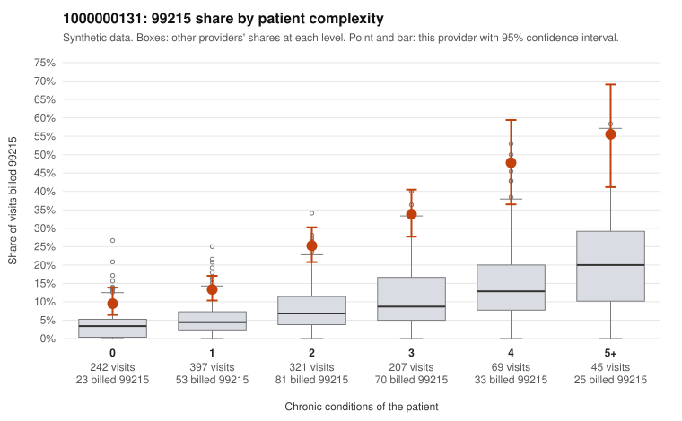

# 1000000131: 1000000131: too few returned records to judge

**Leaning (advisory):** Inconclusive

## Why

1000000131 billed 99215 on 22.2% of 1,281 claims against an expected 5.8% given patient complexity (risk-adjusted score 9.48; plain z-score vs peers 2.76). 27% of this provider's 99215 claims were on patients with 0 or 1 chronic conditions. Records came back for 30 claims. Of 10 documented 99215 claims, 0 (0%) were documented below the billed level, against 21% for the comparison providers. Note checks on 30 returned notes (share showing each sign): problems 17%, late 0%, unsigned 0%, data 3%. No audit trail was received. 1 of 18 notes claiming moderate-or-higher data reviewed had no lab or test line on the claim. The evidence does not support a call either way yet. Examples: C0060925: billed 99214; documented MDM level low, 26 minutes. C0060766: billed 99215, patient aged 49 with 1 chronic condition(s) (type 2 diabetes). C0060795: billed 99215, patient aged 39 with 0 chronic condition(s).

## Evidence chart

## Cited claims

`C0060925`, `C0060766`, `C0060795`

## Suggested next steps

- 30 charts came back but do not settle it: request a targeted sample of 99215 charts, starting with C0060925, C0060766, C0060795.
- Re-check after the targeted charts arrive; do not call upcoding or a sicker panel on this evidence alone.

---
Citations checked: 3/3 valid. Synthetic data. The leaning is advisory; the flag comes from the statistical screen, and no clinical documentation is available beyond the sampled records-review facts shown in the packet.
