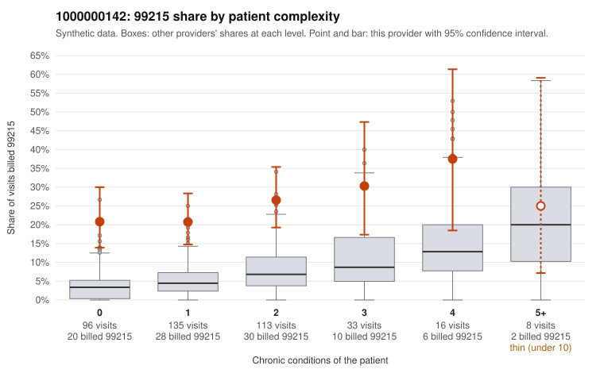

# 1000000142: 1000000142: too few returned records to judge

**Leaning (advisory):** Inconclusive

## Why

1000000142 billed 99215 on 23.9% of 401 claims against an expected 5.2% given patient complexity (risk-adjusted score 6.29; plain z-score vs peers 3.07). 50% of this provider's 99215 claims were on patients with 0 or 1 chronic conditions. Records came back for 30 claims. Of 8 documented 99215 claims, 0 (0%) were documented below the billed level, against 21% for the comparison providers. Note checks on 30 returned notes (share showing each sign): problems 30%, late 13%, unsigned 0%, data 10%. No audit trail was received. 3 of 22 notes claiming moderate-or-higher data reviewed had no lab or test line on the claim. The evidence does not support a call either way yet. Examples: C0064568: billed 99214; documented MDM level low, minutes not recorded. C0064934: billed 99214; documented MDM level low, minutes not recorded. C0064522: billed 99215, patient aged 29 with 0 chronic condition(s). C0064530: billed 99215, patient aged 55 with 1 chronic condition(s) (type 2 diabetes).

## Evidence chart

## Cited claims

`C0064568`, `C0064934`, `C0064522`, `C0064530`

## Suggested next steps

- 30 charts came back but do not settle it: request a targeted sample of 99215 charts, starting with C0064568, C0064934, C0064522.
- Re-check after the targeted charts arrive; do not call upcoding or a sicker panel on this evidence alone.

---
Citations checked: 4/4 valid. Synthetic data. The leaning is advisory; the flag comes from the statistical screen, and no clinical documentation is available beyond the sampled records-review facts shown in the packet.
