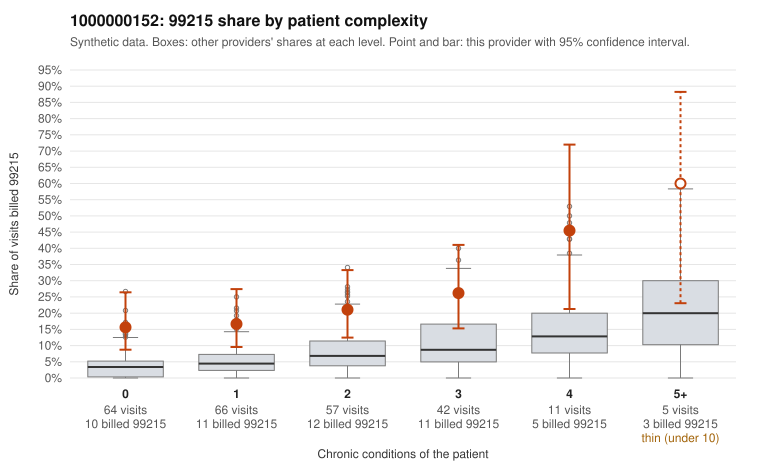

# 1000000152: 1000000152: 6 of 9 documented 99215 claims (67%) are documented below the billed level

**Leaning (advisory):** Pattern consistent with upcoding

## Why

1000000152 billed 99215 on 21.2% of 245 claims against an expected 5.5% given patient complexity (risk-adjusted score 3.99; plain z-score vs peers 2.57). 40% of this provider's 99215 claims were on patients with 0 or 1 chronic conditions. Records came back for 30 claims. Of 9 documented 99215 claims, 6 (67%) were documented below the billed level, against 21% for the comparison providers. Note checks on 30 returned notes (share showing each sign): problems 30%, late 10%, unsigned 0%, data 3%. No audit trail was received. 2 of 18 notes claiming moderate-or-higher data reviewed had no lab or test line on the claim. This pattern is consistent with upcoding. It is a reason to review the records, not a finding. Examples: C0068112: billed 99215, patient aged 45 with 1 chronic condition(s) (hyperlipidemia); documented MDM level moderate, 23 minutes. C0068246: billed 99215; documented MDM level moderate, minutes not recorded. C0068277: billed 99215, patient aged 42 with 1 chronic condition(s) (obesity); documented MDM level moderate, 25 minutes. C0068086: billed 99215, patient aged 47 with 1 chronic condition(s) (atrial fibrillation). C0068088: billed 99215, patient aged 45 with 1 chronic condition(s) (heart failure). C0068097: billed 99215, patient aged 43 with 0 chronic condition(s).

## Evidence chart

## Cited claims

`C0068112`, `C0068246`, `C0068277`, `C0068086`, `C0068088`, `C0068097`

## Suggested next steps

- Request the full charts for C0068112, C0068246, C0068277 and have a certified coder re-score each against the current E/M rules (medical decision making or total time).
- If the re-scoring confirms the pattern, review the random sample in the recovery packet's sampling plan before any overpayment estimate; do not extrapolate from a targeted sample.
- Look at the notes themselves: 30% address fewer problems than their level implies and 10% were signed late; request the audit trail for C0068112, C0068246, C0068277.

---
Citations checked: 6/6 valid. Synthetic data. The leaning is advisory; the flag comes from the statistical screen, and no clinical documentation is available beyond the sampled records-review facts shown in the packet.
