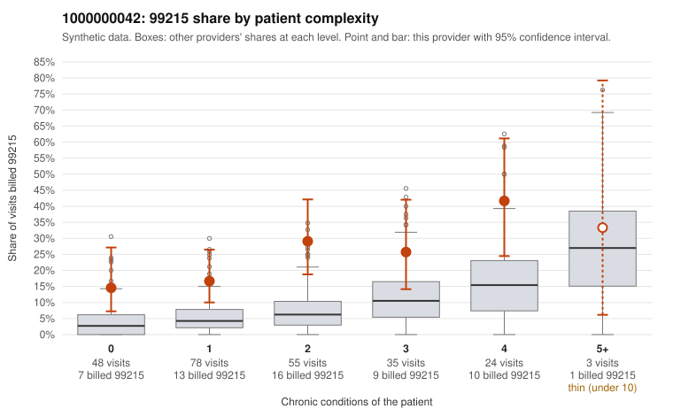

# 1000000042: 1000000042: 4 of 7 documented 99215 claims (57%) are documented below the billed level

**Leaning (advisory):** Pattern consistent with upcoding

## Why

1000000042 billed 99215 on 23.0% of 243 claims against an expected 6.3% given patient complexity (risk-adjusted score 3.59; plain z-score vs peers 2.22). 36% of this provider's 99215 claims were on patients with 0 or 1 chronic conditions. Records came back for 30 claims. Of 7 documented 99215 claims, 4 (57%) were documented below the billed level, against 32% for the comparison providers. Note checks on 30 returned notes (share showing each sign): problems 13%, late 7%, unsigned 0%, data 3%. No audit trail was received. 2 of 14 notes claiming moderate-or-higher data reviewed had no lab or test line on the claim. This pattern is consistent with upcoding. It is a reason to review the records, not a finding. Examples: C0018427: billed 99215; documented MDM level moderate, 35 minutes. C0018431: billed 99215; documented MDM level moderate, 27 minutes. C0018445: billed 99215, patient aged 32 with 0 chronic condition(s); documented MDM level moderate, 37 minutes. C0018357: billed 99215, patient aged 38 with 1 chronic condition(s) (COPD). C0018358: billed 99215, patient aged 47 with 1 chronic condition(s) (asthma). C0018368: billed 99215, patient aged 51 with 1 chronic condition(s) (type 2 diabetes).

## Evidence chart

## Cited claims

`C0018427`, `C0018431`, `C0018445`, `C0018357`, `C0018358`, `C0018368`

## Suggested next steps

- Request the full charts for C0018427, C0018431, C0018445 and have a certified coder re-score each against the current E/M rules (medical decision making or total time).
- If the re-scoring confirms the pattern, review the random sample in the recovery packet's sampling plan before any overpayment estimate; do not extrapolate from a targeted sample.
- Look at the notes themselves: 13% address fewer problems than their level implies and 7% were signed late; request the audit trail for C0018427, C0018431, C0018445.

---
Citations checked: 6/6 valid. Synthetic data. The leaning is advisory; the flag comes from the statistical screen, and no clinical documentation is available beyond the sampled records-review facts shown in the packet.
